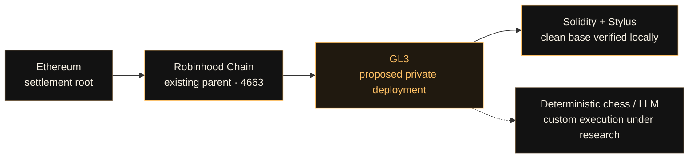

# GH0ST L3 · GL3

**A Robinhood-settled execution layer for GH0ST.**

Private, low-traffic compute. GH0ST as proposed native gas. Solidity and Stylus at the base, with deterministic chess and language-model execution researched as separate extensions.

[Research history](research/gl3/HISTORY.md) · [Findings](research/gl3/FINDINGS.md) · [Roadmap](research/gl3/ROADMAP.md) · [Live research status](research/gl3/status.json) · [Source & evidence](research/chess/l3/README.md)

> **Research branch, 16 November 2026.** The base chain is verified locally. A public GL3 deployment, production hosting and fully on-chain Stockfish execution are not yet established. The current workload study uses the unchanged full-strength chess engine.

## What the evidence shows

| Milestone | Measured result | Scope |
| :--- | :--- | :--- |
| Clean base | Pinned Nitro 3.12.2, ArbOS 61, standard Stylus, debug extensions off | Actual local node |
| Responsive receipts | 96/96 lightweight transactions; worst workload p95 ≈105 ms | Local M5 benchmark, not hosted inference speed |
| Nested rollup | Real Geth → Nitro parent → Nitro child; validated genesis and native mock-token deposit | Local three-layer functional rehearsal |
| Parent inclusion | Exact signed child transaction decoded from posted parent batch2 | Actual local calldata and receipts |
| Fresh child footprint | **179.25 MiB peak RSS · 2.08 MiB chain data** | Excludes model, validator/staker and prover work |
| Full-strength chess | Full NNUE · **24m nodes · Hash 128 · one worker** | Full-game memory measurement running |

[Receipt benchmark](research/chess/l3/core/node/evidence/receipt-benchmark.json) · [Rollup evidence](research/chess/l3/core/integration/README.md) · [Memory methodology](research/chess/l3/core/hosting/chess-workload-20261116/README.md)

## Architecture direction

The diagram shows the intended public topology. The completed test used a local Ethereum fixture, a local RH-like parent and a local child. Hosting Stockfish beside a node is a capacity test; it does not make the search part of the chain's verified state transition.

## Research notebook

| Read first | Purpose |
| :--- | :--- |
| [Chronological history](research/gl3/HISTORY.md) | Why each decision changed, with evidence and preserved limitations |
| [Current findings](research/gl3/FINDINGS.md) | Performance, memory, gas-token requirements and unresolved production questions |
| [Roadmap](research/gl3/ROADMAP.md) | Completed work, the active experiment and the next gates |
| [Full-strength chess study](research/chess/l3/core/hosting/chess-workload-20261116/README.md) | Immutable strength policy, complete workloads and memory measurements |
| [Hosting research](research/chess/l3/core/hosting/README.md) | Smaller private-node candidates and explicit price/availability boundaries |
| [Core source](research/chess/l3/core/README.md) | Pinned standard base, native-gas work and deployment preparation |
| [Preserved model experiments](research/chess/l3/llm/README.md) | Complete small-model arithmetic and custom-runtime research |

## Immediate objective

Measure the complete selected chess workload before choosing hardware. Keep the full neural network,24m-node budget, Hash 128, maximum skill and per-game retained state. Test recovery and track actual memory instead of assuming that generic public-sequencer hardware guidance is our minimum.

No server has been rented and no public GL3 chain has been funded. Parent posting still consumes ETH even if GL3 uses GH0ST for its own gas. Model integration, fee pricing, validator custody, finality, licensing and public deployment remain distinct review steps.

---

[Original GH0ST project overview](https://github.com/Gh0stllm/GH0ST/blob/b27fcb92e93d07073b4859b2c834909a03fc42b5/README.md) · [GH0ST website](https://gh0st.fyi/) · [Artwork brief](research/gl3/assets/ARTWORK.md)
