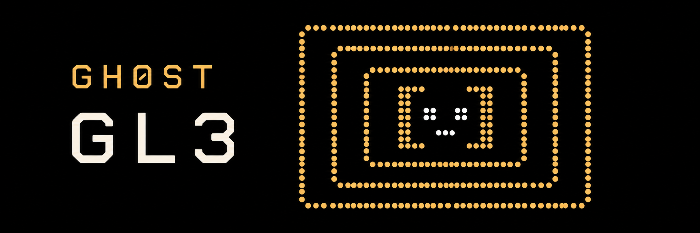
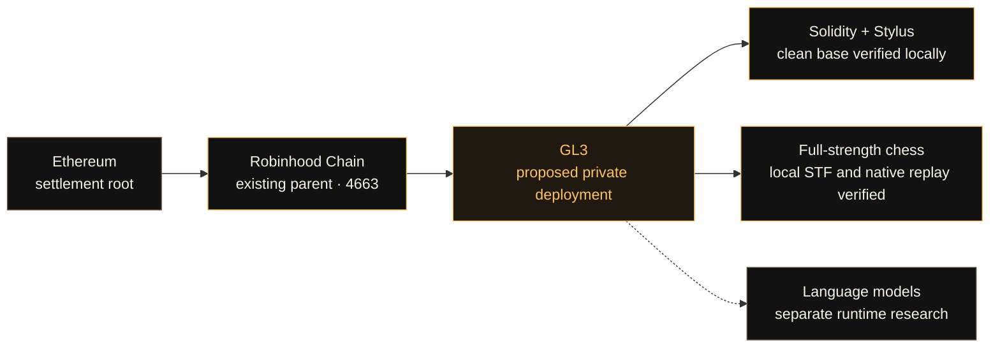
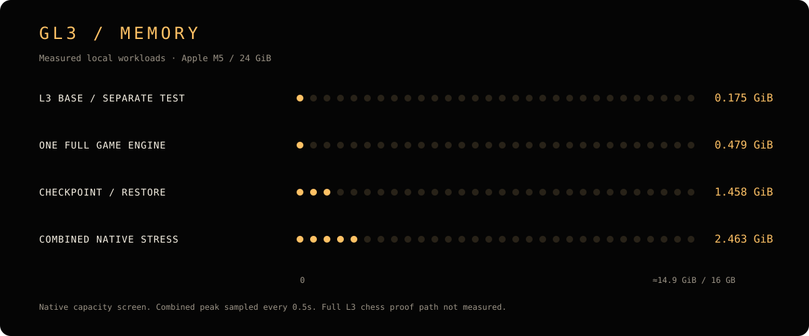

# GH0ST L3 · GL3

**A Robinhood-settled execution layer for GH0ST.**

Private, low-traffic compute. GH0ST as proposed native gas. Solidity and Stylus at the base, with deterministic chess and language-model execution researched as separate extensions.

[Research history](research/gl3/HISTORY.md) · [Findings](research/gl3/FINDINGS.md) · [Roadmap](research/gl3/ROADMAP.md) · [Live research status](research/gl3/status.json) · [Source & evidence](research/chess/l3/README.md)

> **Research branch, 16 November 2026.** The base chain and custom full-strength chess transition execute locally. An actual mined engine-bearing block and independent native replay passed; complete WAVM replay is running. Public GL3 deployment and production hosting remain pending.

## What the evidence shows

| Milestone | Measured result | Scope |
| :--- | :--- | :--- |
| Clean base | Pinned Nitro 3.12.2, ArbOS 61, standard Stylus, debug extensions off | Actual local node |
| Responsive receipts | 96/96 lightweight transactions; worst workload p95 ≈105 ms | Local M5 benchmark, not hosted inference speed |
| Nested rollup | Real Geth → Nitro parent → Nitro child; validated genesis and native mock-token deposit | Local three-layer functional rehearsal |
| Parent inclusion | Exact signed child transaction decoded from posted parent batch2 | Actual local calldata and receipts |
| Fresh child footprint | **179.25 MiB peak RSS · 2.08 MiB chain data** | Excludes model, validator/staker and prover work |
| Full-strength chess | Full NNUE · **24m nodes · Hash 128 · one worker** | 72 prior-history native decisions match; four consecutive native/Wasm checkpoints match exactly |
| Actual chess transition | **18.8s** local mined move; **21.8s** independent complete native replay | Local custom ArbOS profile; exact block hash, send root and inbox position |
| Real OSP witnesses | Actual Stockfish search-loop/arithmetic/memory witnesses verified; corruption rejected | Complete engine-bearing WAVM replay still running |

[Receipt benchmark](research/chess/l3/core/node/evidence/receipt-benchmark.json) · [Rollup evidence](research/chess/l3/core/integration/README.md) · [Memory methodology](research/chess/l3/core/hosting/chess-workload-20261116/README.md)

## Architecture direction

The diagram shows the intended public topology. The completed test used a local Ethereum fixture, a local RH-like parent and a local child. The full chess extension now executes inside actual ArbOS and commits authenticated model/checkpoint data. Its mined-block/replay rehearsal used an actual local Ethereum parent; public Robinhood deployment and full custom nested validation remain separate gates.

## Research notebook

| Read first | Purpose |
| :--- | :--- |
| [Chronological history](research/gl3/HISTORY.md) | Why each decision changed, with evidence and preserved limitations |
| [Current findings](research/gl3/FINDINGS.md) | Performance, memory, gas-token requirements and unresolved production questions |
| [Roadmap](research/gl3/ROADMAP.md) | Completed work, the active experiment and the next gates |
| [Full-strength chess study](research/chess/l3/core/hosting/chess-workload-20261116/README.md) | Immutable strength policy, complete workloads and memory measurements |
| [Active chess integration](research/gl3/chess/README.md) | Exact engine/state parity, mined block, replay artifacts and proof tests |
| [USD 100 hosting plan](research/gl3/chess/HOSTING.md) | Sustained CPU,24 GB target, quoted candidates and acceptance gates |
| [Core source](research/chess/l3/core/README.md) | Pinned standard base, native-gas work and deployment preparation |
| [Preserved model experiments](research/chess/l3/llm/README.md) | Complete small-model arithmetic and custom-runtime research |

## Next build gate

The unchanged engine is integrated in the experimental custom STF. Four complete 24m decisions and all canonical retained state matched across native and scalar Wasm. An actual local mined decision and independent full native block replay passed. The complete WAVM interpreter run and engine-specific Solidity witness checks are the active gate. [Exact results](research/gl3/chess/README.md).

The active server budget is **USD 100/month**, with sustained CPU and recovery taking priority over the cheapest shared VPS. A late sample of the running full prover briefly reached **14.63 GiB RSS on its own**. This is a lower bound from partial sampling, not a16 GB acceptance certificate;24 GB is the user-selected hosting target, with an actual node/prover overlap screen in progress. Parent fees and any one-time setup are separate. [Current hardware plan](research/gl3/chess/HOSTING.md).

No server has been rented and no public GL3 chain has been funded. Parent posting still consumes ETH even if GL3 uses GH0ST for its own gas. Fee pricing, Linux acceptance, validator custody, finality, licensing and public deployment remain distinct review steps. The chart above covers the earlier native-only memory study; it excludes the full prover.

---

[Original GH0ST project overview](https://github.com/Gh0stllm/GH0ST/blob/b27fcb92e93d07073b4859b2c834909a03fc42b5/README.md) · [GH0ST website](https://gh0st.fyi/) · [Artwork brief](research/gl3/assets/ARTWORK.md)
