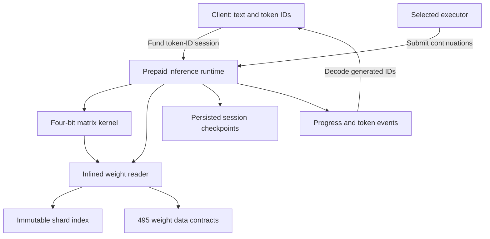

# How GH0ST works

[Documentation guide](README.md) · [Request lifecycle](REQUEST-LIFECYCLE.md) · [Evidence and costs](EVIDENCE.md) · [Project home](../README.md)

GH0ST turns a bounded language-model forward pass into a sequence of deterministic contract operations. The selected weights live in contract bytecode. Solidity computes the numerical steps and stores enough intermediate state to resume in later transactions. An external executor provides transaction submission, rather than model outputs.

*This guide describes the source and deployment records at the 20 October 2026 snapshot. It distinguishes the deployed inference stack from the separately tested controller.*

## Where the work happens

| Location | Responsibility | Implementation or record |
| --- | --- | --- |
| Client, outside the chain | Apply the official chat template, tokenize text, prepare wallet calls, decode generated token IDs | [Frontend integration](../falcon-agent/runtime/FRONTEND-INTEGRATION.md) |
| Executor, outside the chain | Submit continuation transactions and initially pay their network fees | [Prepaid execution](../falcon-agent/runtime/PREPAID-BUDGET.md) |
| Runtime contract | Validate and fund sessions, advance inference, persist state, emit tokens and settle credits | [GH0STRuntime.sol](../falcon-agent/runtime/GH0STRuntime.sol) |
| Matrix kernel contract | Read packed weight tiles and compute bounded integer dot products | [Four-bit study](../falcon-agent/fourbit-study/README.md) |
| Weight index and shards | Provide the pinned export's metadata, addresses and readable model bytes | [WeightReader.sol](../falcon-agent/fourbit-study/WeightReader.sol), [address manifest](../falcon-agent/fourbit-study/mainnet/deployment-manifest.json) |
| Earlier controller study | Enforce owner permissions and bounded actions against its inference-engine interface | [Agent.sol](../falcon-agent/Agent.sol) |



`WeightReader` and `FixedMath` are source libraries, and `PrepaidBudget` is inherited code. They are compiled into the relevant contracts; they do not add three separately deployed helper contracts.

## The deployed weight layer

The selected model has **91,131,072 parameters**. Its chosen export, `affine64_s12z4`, is **48,626,528 bytes**, including descriptors and non-matrix tensors. The matrix portion contains **90,996,736 weight elements** across **217 matrices**. Original non-matrix tensors retain their BF16 bytes.

The export is split into 495 deployed data contracts. An immutable index lists their addresses and file metadata. `WeightReader.read(index, offset, length)` maps a logical file range to the required shard ranges and uses `EXTCODECOPY` to read their bytes, including reads that cross a shard boundary. The kernel can therefore address a matrix inside one logical file without the caller supplying its weights on each continuation.

Each selected group of 64 matrix weights uses 32 bytes of four-bit codes and 2 bytes of scale/zero-point metadata. A matrix also has a shared Q24 scale unit. The exact reconstructed integer weight is:

```text
(code - zero_point) * scale_code * matrix_scale_unit
```

Those integers are interpreted in the export's Q24 convention. The runtime's matrix input is adaptively converted to signed int16; the kernel computes bounded packed products, and the runtime restores the corresponding activation scale.

The immutable runtime constructor pins the expected kernel and index code hashes. The reader validates layout, file bounds and shard lengths. The whole-file SHA-256 identifies the selected export; the full 48 MB file is not hashed again for every read. [Format, pins and validation](../falcon-agent/fourbit-study/README.md#format-and-pins).

## The inference pipeline

A matrix kernel provides linear algebra. A language-model forward pass also needs embeddings, normalization, recurrence or attention, nonlinear operations, residuals and output selection. `GH0STRuntime` implements those stages for the selected model's **24 hybrid blocks**.

| Stage | Runtime behavior |
| --- | --- |
| Input | Read the current token's embedding from the deployed export |
| Block normalization | Compute RMS normalization with deterministic fixed-point arithmetic |
| Sequence processing | Perform Mamba causal convolution/selective recurrence and rotary grouped-query attention |
| Feed-forward processing | Compute the gated MLP, projections and residual updates |
| Output | Apply final normalization and vocabulary projection; choose the greedy next token |
| Continuation | Append the token, stop at EOS/output limit or process the next position |

Activations use signed **Q32** arithmetic, packed into 64-bit values for storage. Four values share a 256-bit storage word. `FixedMath.sol` supplies finite integer approximations for operations such as exponential, logarithm, SiLU, square root and sine/cosine. This introduces approximation beyond the four-bit weight conversion; it is not IEEE float32 execution.

For short contexts, the Mamba implementation reconstructs selective recurrence from decayed historical rank-one updates instead of persisting a full dense recurrent state. Attention retains the required key/value history. The runtime exposes aligned numerical checkpoint reads through `values` and emits layer hashes for comparison with the independent reference.

The current interface accepts positive prompt and output lengths with **at most 64 total tokens** and uses greedy generation. The full 64-token numerical/gas worst case has not been demonstrated. [Runtime behavior and validation](../falcon-agent/runtime/README.md#numerical-behavior-and-remaining-product-work).

## Why computation is resumable

A response is too much work for a single transaction under this implementation's constraints. Each session records its position, layer, phase, cursor, cached matrix input, generated IDs and packed numerical values. A successful `advancePrepaid(id, maxUnits)` performs a bounded amount of work, commits its state and emits progress.

The selected executor may request up to **256 work units** in one continuation. The loop also keeps gas headroom. A later transaction reads the saved state and continues from that exact point. Intermediate prompt positions need no vocabulary projection; output positions do. Consequently, prompt length and generation length both affect total work.

Progress is not the same as a new visible word. Many transactions complete numerical stages without emitting a token. The validated prepaid “Hi” workload took **1,546 continuation transactions** locally for an 11-token templated prompt and 2 generated token IDs. This is a measurement of that workload, not a universal transactions-per-response figure.

## What the executor controls

The requester chooses the executor, and only that address can advance the paid session. The executor selects continuation timing and bounded batch size, subject to the contract's limits and fee caps. The runtime computes its own intermediate activations and token selection; there is no API for an executor to replace them with arbitrary supplied values.

Execution still depends on someone operating a transaction sender with working capital. The requester can replace a stalled executor or cancel and reclaim unused escrow as withdrawal credit. A funded session does not run automatically or guarantee a completion deadline. [Payment and cancellation details](REQUEST-LIFECYCLE.md).

## How the agent controller fits

The earlier `OnchainAgent` controller and `AgentFactory` study is useful work in its own right. It implements owner isolation, engine/model pinning, recipient allowlists, native-transfer limits, an action limit, a persistent note and cancellation. Its 36 local integration checks use `ScriptedEngine`, whose outputs are set by the tests.

The interfaces make the remaining integration explicit:

| Earlier controller expects | Deployed bounded runtime exposes |
| --- | --- |
| `modelId()` | Pinned model/export identities in source and configuration |
| `begin(prompt, observation, tokenLimit)` | `startPrepaid(tokenIds, outputLimit, executor, feeCaps, budget)` |
| `advance(job, work)` | `advancePrepaid(id, maxUnits)` |
| `result(job)` returning a typed action or reply | `status(id)` and token/progress events |

These are different interfaces. A reviewed adapter or revised integration would need to bridge token preparation, prepaid funding, executor authorization, session ownership, output interpretation and action policy. The deployed runtime does not by itself make the earlier controller an operating autonomous agent. [Controller source and historical tests](../falcon-agent/README.md).

## Deployed stack and identity

The recorded active four-bit inference stack is **498 contracts**: 495 weight shards, one kernel, one index and one runtime. Two older six-bit pilot contracts bring the historical deployment total to **500**.

| Contract | Recorded address |
| --- | --- |
| Prepaid inference runtime | `0x69996912a59a241763c71810193cf1021ddbb8c0` |
| Four-bit matrix kernel | `0x0200026e314067c01ac69665d2386d45d156e7b8` |
| Immutable weight index | `0x4a5aaa46e02b8cbd3fa2c39802a3e8339c98ada0` |

[Runtime deployment receipt and bytecode hash](../falcon-agent/runtime/mainnet-runtime.json) · [Frontend configuration](../falcon-agent/runtime/frontend-config.json) · [All weight addresses](../falcon-agent/fourbit-study/mainnet/deployment-manifest.json)
