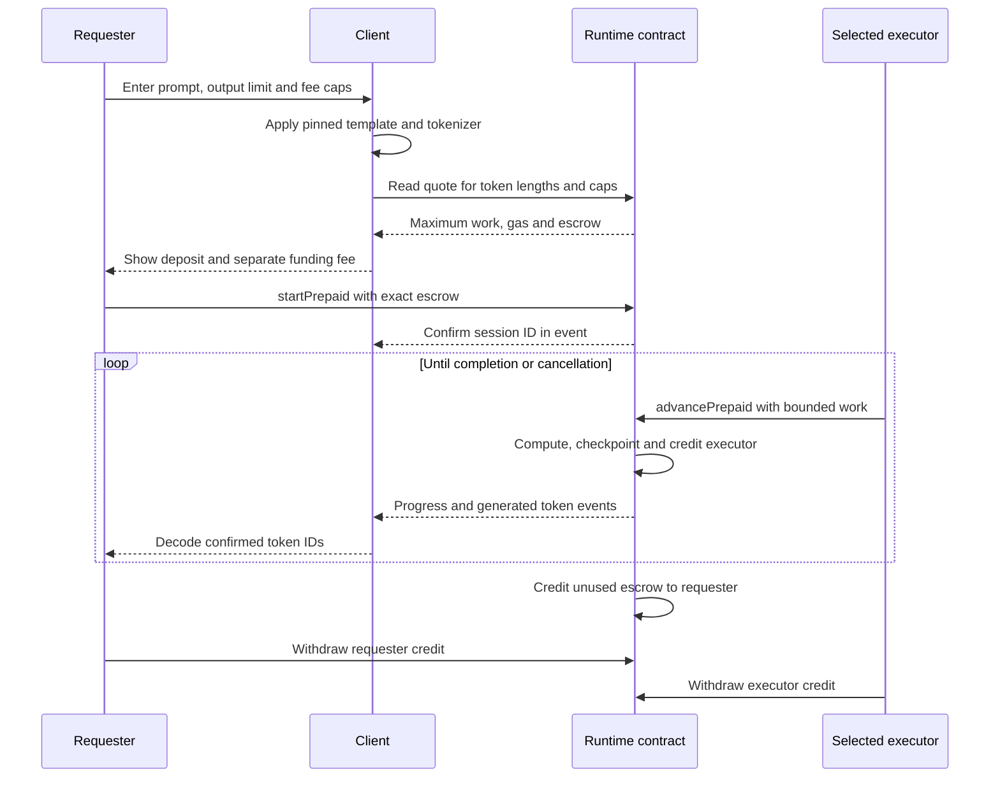

# From a prompt to a result

[Documentation guide](README.md) · [Architecture](ARCHITECTURE.md) · [Evidence and costs](EVIDENCE.md) · [Project home](../README.md)

The requester funds execution before it begins. A chosen executor then submits transactions that advance the model's contract-computed state. Generated token IDs are read from chain state/events and decoded by the client. Unused escrow becomes a withdrawal credit when generation completes or the requester cancels.

*This is the intended interaction with the deployed interface at the 20 October 2026 snapshot. The repository records local end-to-end validation; it does not record a paid public chat, connected website chat or an operating executor service.*

## The successful path



## 1. Prepare the request

The client uses the selected model's official tokenizer and chat template at the pinned revision. Human text is converted to integer token IDs outside the chain. The same tokenizer decodes generated IDs. The current contract accepts positive prompt/output lengths with `promptTokens + maxNewTokens <= 64`.

The requester selects an executor address and approves two ceilings: a gas price in wei/gas and a parent-posting fee in wei per continuation. An executor can be the requester or a separately operated sender. In either case, it needs funds available to pay continuation fees before withdrawing earned credits.

Use the published [configuration](../falcon-agent/runtime/frontend-config.json) and [ABI](../falcon-agent/runtime/frontend-abi.json), verify chain ID **4663**, and check the runtime against its [recorded code hash](../falcon-agent/runtime/mainnet-runtime.json). [Implementation instructions](../falcon-agent/runtime/FRONTEND-INTEGRATION.md).

## 2. Read and review the quote

`quote(P, O, G, L)` is a read-only calculation, where P is prompt length, O is the maximum output length, G is the approved gas-price cap and L is the posting-fee cap per successful continuation:

```text
maximumUnits    = (P + O - 1) * 2161 + O * 129
executionGasCap = maximumUnits * 31_000_000
budgetWei       = executionGasCap * G + maximumUnits * L
```

This is a **conservative maximum refundable service deposit**. It covers the allowed work even under very small successful batches. It does not predict exact future fees, promise that every numerical input finishes, or estimate the expected charge of a typical response.

For the validated 11-prompt-token, 2-output-token workload, the bound is **26,190 units** and **811,890,000,000 maximum billed execution gas**. Actual local continuation receipt gas was **33,891,488,817**. Those figures measure a cap and an observed workload respectively. The client must show them separately and enforce an explicit maximum deposit. [Exact budgeting specification](../falcon-agent/runtime/PREPAID-BUDGET.md).

## 3. Fund the session

The requester submits `startPrepaid` with the prompt IDs, output bound, executor, fee caps and expected budget. The contract recomputes the budget and requires both `expectedBudgetWei` and `msg.value` to equal it. Funding and session creation succeed together or revert together.

Obtain the session ID from the confirmed `SessionStarted` or `Prepaid` event. A `nextSession()` read before submission is not a reservation; another request can be included first. Funding/start transaction fees are paid separately by the requester's wallet.

## 4. Advance the computation

Only the chosen executor calls `advancePrepaid(id, maxUnits)`, with 1–256 requested work units. Each successful call advances the runtime's deterministic state, subject to gas headroom, and receives bounded credit from the session escrow.

The billing rule is:

```text
billedGas  = gasAtEntry - gasBeforeSettlement + 120_000
paymentWei = billedGas * tx.gasprice + currentTransactionPostingFee
```

The runtime enforces the approved caps and a **31,000,000 billed-gas ceiling per successful continuation**. The fixed overhead is a disclosed accounting allowance; it is not an exact reconstruction of final receipt gas. The chain's current parent-posting charge is read through ArbGasInfo. Missing or malformed posting-fee data causes a revert.

This cap is not the same thing as a complete Nitro transaction gas-limit estimate. The executor still needs live execution/posting estimates and must account for the target chain's transaction limits. Failed/reverted calls do not earn reimbursement from the escrow.

## 5. Display results

Read `status(id)` and reconcile it with `Progress`, `Token` and `Finished` events. Decode confirmed generated IDs using the pinned tokenizer. A continuation can advance layers or matrix tiles without producing any visible text. Reconnecting clients should rebuild their view from confirmed state/events and handle chain reorganizations.

`values(id, base, count)` exposes aligned numerical checkpoints for inspection. Session inputs, intermediate values and generated tokens are public; token IDs do not provide conversation privacy.

## 6. Complete, cancel or replace the executor

| Situation | Contract behavior | Requester result |
| --- | --- | --- |
| Output limit or EOS ends generation | Finish inference and release unused escrow to credit | Withdraw remaining credit explicitly |
| Executor stalls | Requester calls `setExecutor` | A replacement continues from saved state under the same caps |
| Requester stops early | Requester calls `cancel` | Unused escrow becomes requester credit; earned executor compensation remains spent |
| Network fees exceed a cap | Continuation reverts | Wait for compatible fees, replace the executor or cancel; caps do not silently increase |
| Numerical execution cannot continue | A continuation may revert | Cancellation can release the remaining escrow; completed work is not refunded |
| A withdrawal recipient rejects payment | Withdrawal reverts atomically | Credit remains available; use a different recipient |

Refunds and executor earnings are **pull payments** through `credits(account)` and `withdraw(recipient)`. A refund credit is not an automatic wallet transfer. `totalLiability` includes both active escrows and unwithdrawn credits; settlement reassigns that liability, and successful withdrawal reduces it.

## Who pays what

| Cost | Initial network payer | Escrow treatment |
| --- | --- | --- |
| Session funding/start | Requester | Separate network fee |
| Successful continuation | Selected executor | Receives contract-calculated, capped withdrawal credit |
| Failed/reverted continuation | Selected executor | No reimbursement |
| Cancellation or executor replacement | Requester | Separate network fee |
| Credit withdrawal | Account submitting its withdrawal | Separate network fee |
| Unused escrow | Already funded by requester | Becomes requester credit at completion/cancellation |

The present implementation charges no platform commission and has no administrator sweep of escrow. The requester can choose themselves as executor, while retaining the working-capital requirement for sending transactions.

## Can all continuations be batched into one transaction?

The current contract allows **one paid continuation across all sessions per transaction**. A transient-storage guard prevents charging a transaction's complete parent-posting fee twice. Multicalling multiple paid continuations therefore reverts.

A sender can arrange multiple separate transactions as an operational submission strategy, but each remains an individual transaction with its own limits and charges. This does not collapse the model's computation into a single call. [Settlement and transaction guard](../falcon-agent/runtime/PrepaidBudget.sol).
