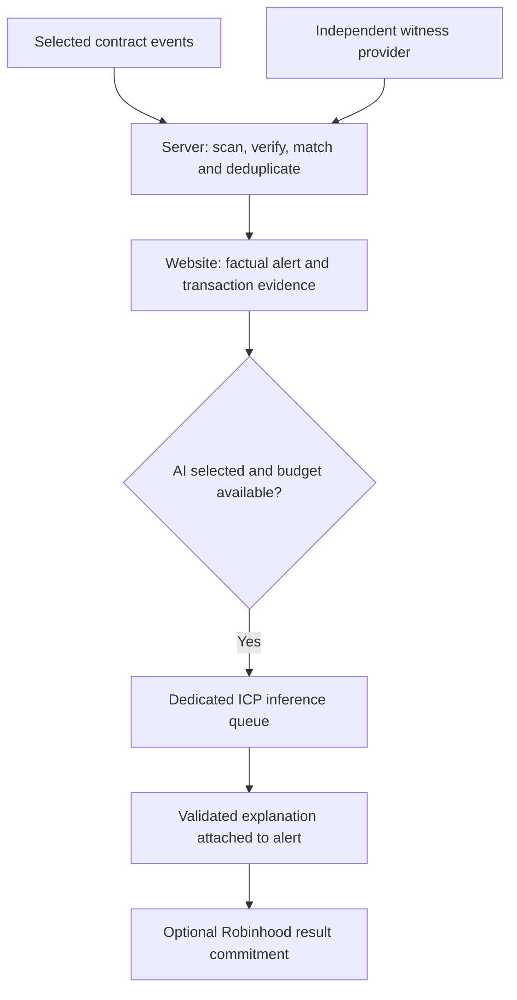

# GH0ST Watch research

Research checkpoint: 3 November 2026. Branch: `research/gh0st-watch`, based on `main` at `ba894be88a230685ba310d8500eb77a156f4a855`.

**Status: proposed design and operating-cost model. Watch has not been implemented, deployed or benchmarked end to end.** Native-model screens and a separate local ICP audit-model/cost experiment are available; neither is an end-to-end Watch benchmark. This checkpoint creates no paid service, chain transaction, recurring monitor or spending authorization.

Research updates: [optimization and cost controls](OPTIMIZATION.md), [alert model tests](MODEL-SELECTION.md), and [contract-audit model recommendation](CONTRACT-AUDIT-MODELS.md), and [downloadable models: measured ICP results and costs](ICP-AUDIT-RESULTS.md). Contract auditing is a separate workload from generating short alert text.

GH0ST Watch would monitor selected public contracts, publish factual alerts with transaction evidence, and optionally explain selected alerts using a dedicated ICP model deployment. The first product should be useful even when AI is disabled or unavailable.

## How it would work

1. **Choose a watch.** Select a supported contract and a typed rule, such as an ERC-20 transfer above a token-unit threshold. Start with one reviewed token contract and one event type. Proxy upgrades and liquidity changes require separate protocol-specific adapters; a generic event signature does not prove their meaning.
2. **Observe cheaply.** A small server reads new logs through a node provider, saving its last processed block. Use a shared scan for watches on the same chain rather than separate polling loops for every user. A 30-second scan target is a proposal, not a delivery guarantee.
3. **Verify and match.** Check chain, contract, exact event decoding, receipt success, block hash and confirmation policy against two independently operated providers. Deduplicate by source identity. Save progress durably and recover missed ranges after downtime. Hold alerts when providers disagree; retract or correct alerts if their source is later reorganized.
4. **Publish the factual alert.** Show the exact event, timestamp, rule matched and explorer link in the Watch website inbox. Example: “The watched treasury sent 25,000 TOKEN to 0x…; your 10,000 TOKEN threshold was crossed.” The numbers come from code, not a language model. USD thresholds require a separately specified price feed and stale-price rules.
5. **Explain selectively.** An optional queue sends a compact, validated fact packet to a dedicated ICP model. The model may summarize those facts but must not invent ownership, intent or risk conclusions. Check amounts, addresses and source references before showing its explanation. Keep the factual alert visible if explanation fails. AI could take minutes; measure it before promising a response time.
6. **Retain evidence.** Save source facts, rule version, model/prompt version, output, costs and status. A later option could publish a signed result hash or a batch commitment on Robinhood. Ordinary read-only monitoring requires no on-chain transaction. A signature authenticates an attestation; it does not prove the explanation is true or prove each model operation.

The server handles observation, queueing and website delivery. ICP handles optional model inference. This is a hybrid design, not a claim that every step executes on Robinhood. Keep Watch state, budgets and inference separate from Whispers. Bounded retries and a per-job cycle allowance are necessary; the earlier uncapped worker is not an appropriate default for Watch. Budget checks must reserve in-flight call costs, not merely check balances between chunks. Stop accepting AI work at the monthly limit while continuing factual alerts.

## Existing foundations and new work

The local AgentKit source has an exact v4 swap-event adapter, two-provider checks, deduplication, bounded tool execution and receipt concepts. These are foundations, not a general monitoring product. Watch still needs typed adapters, watch configuration, durable block cursors, reorganization handling, a website inbox, cost controls and an independently measured explanation workload. No existing paid public inference service is assumed.

## Cost evidence

The following are dated observations from existing GH0ST research records inspected on 3 November, not new Watch measurements. `T` means one trillion ICP cycles.

| Historical workload | Recorded consumption | Scope |
| --- | ---: | --- |
| 26 October short pilot, 242 input / 16 output tokens | 1.420489T | Model + coordinator for corrected inference window |
| Same pilot including failed preflight/recovery | 1.468863T | Excludes earlier model upload, canister creation and installation |
| 27 October operational sample: 12 published, 3 failed | 1.970893T per published result | Model only, includes failed jobs in that sample |
| 26 October operational sample: 27 complete, 11 failed | 70.858089T total; 2.624374T per completed result | Model only, sum of terminal jobs divided by completions; job totals can include retries |
| Largest failed job in that sample | 11.042969T | Illustrates why uncapped retries cannot be used for budgeting |
| One recorded Robinhood callback | 136,975 gas; 0.0000027493622 ETH | Historical callback only, not the complete paid-request lifecycle |

Source record names, relative to the local GH0ST research workspace: `rh-icp-live/rh-icp-inference/LIVE-STATUS.md`, `output/server-migration/20261027/refill-runway-estimate.json`, `output/icp-funding/topup-now-20261026-operation.json`, and `rh-icp-live/rh-icp-inference/build/mainnet/progress.json`. These source records are not bundled in this branch. The table is a summarized historical observation, not a newly reproducible public benchmark. Future Watch results should include sanitized raw measurements and a reproduction procedure.

[ICP pricing](https://docs.internetcomputer.org/references/cycle-costs/) fixes 1T cycles at 1 XDR. Its displayed USD examples use a dated exchange rate. For this planning model only, assume **USD 1.40 per T**, not a verified current exchange quote. That makes the short pilot about $1.99 for model plus coordinator. The two operational samples cost about $2.76 and $3.67 in model consumption alone per completed output. A useful Watch explanation may use more input/output tokens and cost more.

## Proposed monthly budget

Assumptions: one chain, 10-25 low-volume watches, shared log scans around every 30 seconds, modest website traffic, short AI explanations, 30 days, no SMS, and no high-availability cluster. Historical backfill and high-event-rate contracts need separate sizing. One polling call every 30 seconds is already 86,400 calls/month before log queries and verification; provider compute-unit charges are method-dependent.

Use **$25-100/month fixed infrastructure** as an engineering allowance, plus **$3-5 per completed AI explanation** as a provisional variable allowance. These are modeled budgets, not measured Watch costs, provider quotes or hard upper bounds.

| Fixed-cost component | Planning allowance / month | Basis |
| --- | ---: | --- |
| Observer, queue and small database | $12-24 | Current DigitalOcean 2-4 GiB Basic plans; inference runs elsewhere |
| Backups | $3-8 | Allowance; select retention and obtain the exact plan price |
| Two-provider node access | $0-50 | Free-tier pilot only if supported limits suffice; one paid provider plus a qualifying independent free witness is an illustrative configuration |
| Modest website/log storage and ICP idle memory | $2-8 | Assumes existing website capacity, 2-4 GiB model state on a 13-node subnet and zero reserved compute allocation |
| Rounded fixed budget including headroom | $25-100 | Component range above is $17-90; account-specific subscriptions remain unverified |

The $3-5 variable allowance extrapolates the historical model observations and adds room for coordinator verification/signing, bounded failures and small optional callback fees. It is not a measured end-to-end Watch fee. The historical callback can be repriced as `0.0000027493622 ETH x ETH/USD`; a new contract or fee environment can differ. No callback is needed for the basic website-only alert. Do not count failed attempts twice when using a per-success figure that already includes them.

| Completed AI explanations per day | Explanations / 30 days | Modeled monthly operating budget |
| --- | ---: | ---: |
| 0: factual monitoring only | 0 | $25-100 |
| 1 | 30 | $115-250 |
| 5 | 150 | $475-850 |
| 10 | 300 | $925-1,600 |
| 100 | 3,000 | $9,025-15,100 |

Formula: `fixed monthly cost + 30 x explanations/day x variable cost per explanation`.

These are workload scenarios, not throughput promises. The 100/day row is a cost sensitivity calculation; a single model may not sustain that rate. Batching changes prompt size and cost, so “one daily digest” must be benchmarked separately rather than assumed to cost the same as one short alert.

The estimates exclude development labor, tax, a new domain, SMS/paid notification services, unusual bandwidth, archive backfill, high availability, reserved compute and new customer-payment contracts. Existing hosting capacity could reduce incremental cost, but has not been checked. Do not call a partial inference figure the total bill.

Provider references checked 3 November 2026: [DigitalOcean](https://www.digitalocean.com/pricing/droplets) lists 2 GiB at $12/month and 4 GiB at $24/month; [Alchemy](https://www.alchemy.com/pricing) lists 30M free compute units/month; [Quicknode](https://www.quicknode.com/pricing) lists a $49 monthly Build tier before annual discounts. Chain/method eligibility and independent-provider limits must be checked for the chosen accounts. [Robinhood documentation](https://docs.robinhood.com/chain/connecting/) says public endpoints are rate-limited and not recommended for production. ICP storage at 127,000 cycles/GiB-second is about 0.329184T/GiB per 30 days on a 13-node subnet; actual idle burn also depends on configured resources and calls.

## Setup cost and reserves

A separate AgentKit preparation estimate allowed **6-9T consumed** for setup/testing and **15-20T initially funded**, with the difference retained as working reserves. At the planning conversion, these are about **$8.40-12.60 consumed** and **$21-28 funded**. The historical model upload/load/smoke plus relay consumed 3.405672T, excluding creation/install. These are reference points only: Watch has no deployment plan or measured setup total yet. Watch-specific benchmarks, contract deployment and any retry costs must be added. Funding a reserve is not the same as spending it, and no funding is authorized by this document.

## Research sequence

1. Build one token-transfer watch with deterministic alerts and local fixtures. Prove deduplication, decimal/threshold handling, restart recovery, removed/reorganized logs and provider disagreement handling.
2. Run a bounded read-only observation study: record requests and provider compute units, matching-event volume, delay and storage growth. Do not generate AI for every poll.
3. Prepare a dedicated-model benchmark proposal with explicit costs. Compare compact fact packets and 16/32/64-token explanations; measure factual accuracy, latency and model + coordinator cycle deltas, including failures and cleanup. Keep top-ups outside the measurement window or reconcile them explicitly.
4. Price complete lifecycle costs: creation/install/upload, idle baseline, observation, inference, signing, result recording, website delivery and refunds if payments are later added. Separate one-time consumption from retained reserves.
5. Publish measured median and tail costs, completion rates and capacity before offering a public price. Preserve deterministic notifications whenever AI is delayed or its budget is exhausted.

Initial recommendation: factual alerts first, with at most one short AI explanation per day during the pilot. Planning budget: **$115-250/month operating cost**, plus separately measured setup and development. A hard spend limit would govern acceptance of AI work; it would not guarantee 30 successful explanations.
