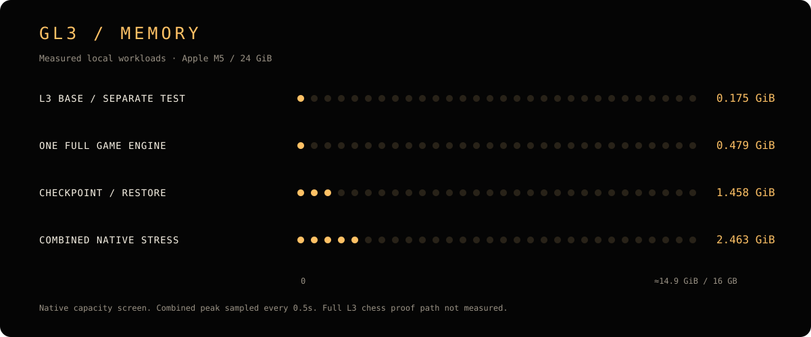

# Current findings

[Overview](../../README.md) · [History](HISTORY.md) · [Roadmap](ROADMAP.md)

## Verified locally

| Question | Finding | Practical limit |
| --- | --- | --- |
| Does the standard base execute? | Real Nitro/Stylus node; standard source and official consensus-v61 machine | No public GL3 deployment |
| Is the base responsive? |96 lightweight successes; configured 100 ms minimum block delay; worst workload p95 ≈105 ms | Local M5, not sustained capacity or inference latency |
| Does the nested token/transaction route work? | Real local Geth → Nitro → Nitro, GHMOCK lock/native credit and exact signed transaction in parent batch2 | Mock funds, development finality; no fraud challenge |
| How large is a fresh child? |179.25 MiB peak RSS;2132 KiB allocated chain-data directory | No model, staker, block-validator or prover peak included |
| Is the chess model small enough to inspect? | Full NNUE98,511,183bytes; pinned SHA and full 24m-node policy | File size is not live execution memory |
| Have we tested all on-chain chess layers? | No. Existing native and ICP engines are separate from the standard L3 | No L3 Stockfish replay/prover capacity claim |

[Core evidence](../chess/l3/core/README.md) · [Full-strength workload](../chess/l3/core/hosting/chess-workload-20261116/README.md)

## What controls hardware sizing

**RAM** holds the full neural network,128MiB transposition table, histories, search/runtime memory, checkpoint copies and chain/replay/prover state. Fixed node count preserves the work even on a slower CPU. Fewer concurrent searches can reduce peak RAM without reducing each decision's work.

**CPU** controls how long24m nodes take. Shared hosting can change latency and jitter without changing the configured search budget. A hard time deadline must not silently return a reduced search.

**Disk** holds executable/model artifacts, committed state, retained checkpoints, history and operational logs. Very few transactions help history growth; one heavy state transition or repeated full checkpoint persistence can still create significant work. Build caches are not mandatory production chain storage.

The team needs the GL3 child and parent RPC connectivity, not locally hosted full Ethereum and Robinhood chains. The extra two layers in the functional test were test infrastructure.

## Economics that remain real

GH0ST native gas does not remove parent ETH posting charges. The SDK requires an explicit compatible custom-token fee-pricer configuration; its rate and safe reimbursement policy remain unselected. Validator collateral, custody, license applicability and independent recovery still need review. A small single host can preserve computation quality while remaining a single failure domain.

The earlier large AWS fleet is a public-availability reference, not a private-chain minimum. Current smaller provider quotes and their billing terms are in the [hosting study](../chess/l3/core/hosting/price-research/README.md). A16 GB final recommendation waits for the selected full-strength measurements and their remaining replay/prover boundary.

## Claim policy

A local benchmark is not a hosted acceptance test. A compiled replay artifact is not an executed proof. A native engine beside a node is not verified on-chain inference. Public execution requires receipts and deployed artifact identities. Each new result records the exact policy, runtime, hardware, resource scope and remaining gaps.

## Full-strength chess memory result

The two complete recorded game histories executed **72 Black decisions at the unchanged 24m-node policy**, matching every prior move, actual node count and completed depth. Five additional 24m searches verified exact retained-state recovery. One game engine peaked at490.14 MiB; the recovery probe peaked at1.46 GiB. The simultaneous workloads plus harness reached a **2.463 GiB sampled aggregate peak** on the24 GiB M5 host.

This supports16 GB for the measured native engine workload; it is not a16 GB Linux acceptance test or a complete L3 chess/prover memory certificate. No new strength or win-rate games are claimed. [Full report](../chess/l3/core/hosting/chess-workload-20261116/README.md), [exact evidence](../chess/l3/core/hosting/chess-workload-20261116/evidence/results.json).

The lowest practical shared-CPU catalog candidate found is OVH8 GB at€8.49 base, conservatively€8.99/month before tax with the undiscounted backup allowance. For at least16 GB, its24 GB plan is€23.49 base, conservatively€24.49 before tax. A netcup8 GB guaranteed-resource alternative is about€25 including displayed19%VAT and IPv4. Stock, invoice eligibility, Linux parity and hosted performance remain unverified. [Pricing rows, terms and primary sources](../chess/l3/core/hosting/chess-workload-20261116/HOSTING.md).
