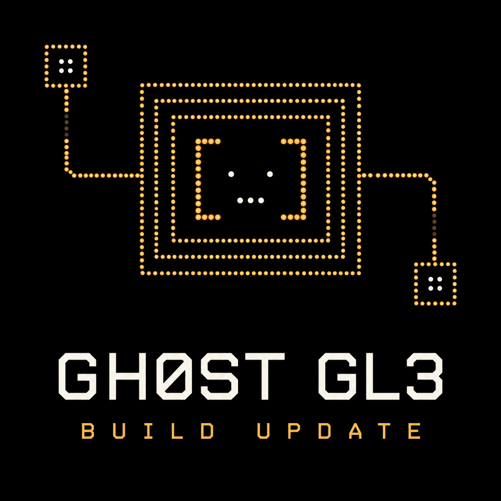

# GH0ST L3 · GL3 research notebook

[Open the full overview](../../README.md) · [History](HISTORY.md) · [Findings](FINDINGS.md) · [Roadmap](ROADMAP.md)

**R37: the native checkpoint preserves the complete bot state and the next full-strength decision. The selected terminal proof is still RUNNING_NOT_ACCEPTED, and its old challenge geometry is too small. Robinhood mainnet is not deployed.**

The isolated A15 profile compacts **2,464 active delta links into 64 authenticated pieces / 162,059,912 body bytes**. Actual StateDB/EVM tests preserve all 466,157,568 memory bytes, globals, TT, history and canonical state; 28 PASS events exit 0. After destroying all VM caches and authenticating a cold restore, the unchanged bot returns **b8c6 / 24,000,311 nodes / depth 39** and the entire frozen canonical hash matches. Default builds keep A15 absent; the selected proof worker and A14 are unchanged. This is **native-only acceptance**. It removes no old code and establishes neither guest-proof nor 20-game storage capacity. [Checkpoint and continuation](mainnet/storage/checkpoint-integration/README.md).

The selected 865 backend and inherited Solidity OSP/manager now pass **two authentic initialization transitions and 14 strict negative checks**. The wrapper starts inner raw 0 at wrapped step 1; a natural raw halt `H` finishes at `H+1`. Synthetic near-2^43 boundary units test the forced-error slot, not a full trace. [Exact offset/cap evidence](mainnet/production/selected865-boundary/README.md).

**A concrete geometry limit was found.** At 02:35:38 UTC on17 November, the running interpreter had sampled at least **1,146,200,000,000 raw steps**, already above `1024^4 = 2^40`. That previous private geometry cannot fit the trace. Final `H`, actual exit, finished state and four-field match remain unaccepted. A separate 2^43 variant is unaccepted preparation and has not launched a lifecycle. [Overflow observation](mainnet/production/bounded-restore/scheduling/comparison/C-combined/interpreter/overflow-observation.json).

Earlier verified results remain: exact native/real-C terminal diagnostic output, repeated GH0ST withdrawal rehearsals and actual native-parent observed-state parity, a full native decision surviving two real process kills, and the selected-source CLI/preflight. Each retains its private/test/diagnostic boundary. [Parallel evidence](mainnet/PARALLEL-ACCEPTANCE.md) · [Full process recovery](mainnet/production/process-recovery/full-decision/README.md) · [Selected CLI](mainnet/production/selected-cli/README.md).

The earlier d453/c03c failures and stopped 48-edge lifecycle remain preserved: zero accepted exact-target one-step, confirmation or collateral-refund results. A full fresh lifecycle still needs an accepted terminal replay and reviewed geometry. [Failed guest](mainnet/production/bounded-restore/evidence/guarded-replay-failure/replay-result.json) · [Stopped audit](mainnet/dispute/full-lifecycle/audit/evidence/stopped-current/stopped-summary.json).

The separate [retention design](mainnet/storage/retention-design/README.md) proposes a reusable page bank to bound current protocol state. It implements no bank, cleanup, archive or pruning. Historical availability, production gas/cold-work bounds, 20 games and an all-in USD 100/month host remain open. All builds, engine work and tests run on Runpod; only the temporary 128 GB worker remains at USD 1.04/hour compute plus disk. No production host, license or new mainnet funding is approved by these results.

| Notebook | Read for |
| --- | --- |
| [History](HISTORY.md) | Sequential decisions, failures and receipt-backed milestones |
| [Linux acceptance](mainnet/README.md) | Passed checks and unresolved launch gates |
| [Release packet](mainnet/release/README.md) | Candidate locks, hosting observations and operator decisions |
| [Findings](FINDINGS.md) | Measured resources and scope |
| [Roadmap](ROADMAP.md) | Achieved work and next testable gates |
| [Machine-readable status](status.json) | Current workload and deployment boundaries |
| [Append-only journal](journal.jsonl) | Ordered research events linked to evidence |

*Creative build-update artwork; not execution proof. [Prompt/provenance](assets/gl3-build-update-20261117.prompt.txt).*

[Active full chess integration](chess/README.md) · [Hosting study](chess/HOSTING.md) · [Chess across fast blocks](chess/sliced/README.md)
