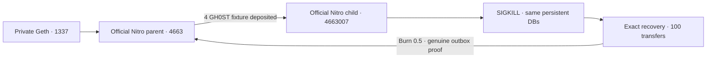

# GL3 base · withdrawal and durable recovery

**The fresh private official-Nitro flow passes: deposit → native-token spend → real SIGKILL recovery → 100 ordinary transfers → outbox withdrawal.** The scenario exits0 in **68.413 seconds**, and every owned chain process has stopped. It runs without a chess engine or model on the dedicated Runpod worker, with the databases on its persistent volume.

[Compact result](evidence/result.json) · [actual exit](evidence/actual-exit.json) · [independent post-run audit](evidence/post-run-audit.json) · [full report](evidence/passed/base-withdrawal-report.json) · [complete evidence capsule](evidence/base-withdrawal-recovery-evidence.tar.gz)

| Check | Measured result |
| --- | --- |
| GH0ST native-gas path | Deposit4, spend1, burn/release0.5; exact gas debit and parent recipient/bridge delta assertions pass |
| Actual crash | Ordinary official CLI killed with SIGKILL; no pre-kill pause, flush or DB copy |
| Recovery | 743ms to the exact captured head/root, message index, sender nonce and balances |
| Persistent identity | All three execution/consensus/Wasm DB devices and inodes match before, after and fresh post-run inspection |
| 100 fresh-account transfers | Local estimate/sign/send/receipt median101ms, nearest-rank p95109ms, maximum123ms |
| Child DB growth during those100 transfers | Allocated6,091,776→7,105,536 bytes; logical51,426→834,137 bytes |
| Withdrawal negatives | Exact `UnknownRoot`, `NotRollup`, altered-leaf `UnknownRoot` and `AlreadySpent` reasons verified |
| Parent storage coverage | 88 transactions traced,5 token-call transactions,7 token storage keys,0 fixture mismatches |
| Cleanup | Primary child actually exits by SIGKILL; four other owned Go processes exit0; all owned PIDs are gone |

The latency and storage figures describe this small private workload. They do not establish public throughput, an SLA, long-run capacity or pruning behavior.

## Exact baseline and recovery check

The native node is official Nitro3.12.2, SHA256 `d9e778d3c513e106dab9de8ef04be9500093b0638cfd463e4d4ec542c214c4ed`, paired with the official `0xc10cd7ec6acaf1c441a3f6bd0900ad20f15855ba775a96f1939118cbc629dc97` machine. Upstream bridge/rollup contracts are pinned to `4341b132cfbdcc980ead03765ca5224ff6cb5d97`. Native ArbSys remains active on the parent, debug precompiles are disabled, and both native nodes strictly validate the independently calculated genesis hash and state root.

The child uses synchronous Pebble, archive state and save-every-block. Its first restart uses the identical CLI binary, arguments, configuration bytes and three database directories. The independent post-run check re-reads their current device/inode values, compares both captured snapshots and reconstructs the original full configuration hash. The batch poster is disabled during this exact-head crash experiment so asynchronous fee reports cannot move the captured head. After recovery and the100 transfers, a separate graceful restart enables only that flag for batching and withdrawal; this later change is excluded from the exact-config recovery claim.

The runtime prefix is `/workspace/gl3/testnet/withdrawal-recovery/` on the configured1,000GB persistent volume. The controller verifies its mount differs from the working disk and checks the actual64,000,000,000-byte cgroup-v2 cap. Filesystem pool free space is not treated as the purchased quota. This is process-crash recovery, not a host-power-loss or replacement-pod test.

## Token and finality boundaries

This job uses GH0ST's frozen real runtime and sparse observed storage. The previous disposable holder's verified32-token balance mapping is explicitly reassigned to a generated test signer in private genesis. Token runtime, metadata and all other copied slots remain unchanged. This is a **synthetic balance-owner remap of a sparse snapshot**, not the complete canonical ledger or a fresh public-state observation. No public RPC, user wallet or real funds are used.

The genuine Rollup/outbox contracts register the send root and release the private token fixture. Confirmation is **privileged fast confirmation**, with no execution-history proof or permissionless BoLD-finality claim. The unit-rate fee pricer is a fixture. Production pricer, roles and permissionless dispute readiness belong to separate launch gates.

Captured transaction evidence contains actual hash/block/gas summaries, assertion/outbox fields and the token trace witness; it does **not** include every complete RPC transaction-receipt JSON. Private configs, generated keys and chain databases are excluded from the public capsule. All exported files passed a scan against the generated private keys.

Earlier genuine observed-state compatibility evidence remains frozen in [native-parent parity](../../mainnet/withdrawal/parent-parity/README.md). The [base dispute lane](../dispute-readiness/) is separate. This result accepts the private functional/recovery scenario, **not production deployment**.

## Preserved failures and reproduction

The first fresh flow reached deposit/spend but exited1 after40.711s: ethers6.13.5's persistent IPC provider emitted an unsupported `close` event when the deliberate SIGKILL closed its socket. Its logs, compact receipts and exact source remain in the capsule. The fix changes only the test transport to a bounded one-shot Unix JSON-RPC query. Five close/error/framing cases pass on Runpod with solc's real unhandled-rejection hook retained. The successful retry reuses the same generated private fixture and asserts byte-identical parent/child genesis JSON inputs. No global error suppression or chain/STF change is used.

The print-only pristine genesis diagnostic builds with exit0 in6.625s, SHA256 `0c797bd8ecf079669ade4ddcd34d2000ec263c51e21831cea3fec71f0618e678`. Its earlier6GB-disk-floor stop is preserved in the [5KB failed-build capsule](evidence/genesis-build-attempt1-capsule.tar.gz) and [receipt](evidence/genesis-build-attempt1-receipt.json).

All compilation, chains, traces, hashes and sealing checks ran on Runpod. Local work was editing, inspection and transfer. [Runner](run.mjs) · [bounded persistent-worker controller](run-cloud.py) · [IPC transport](ipc-rpc.mjs) · [post-run audit/sealer](seal-evidence.py) · [export receipt](evidence/export-receipt.json).
