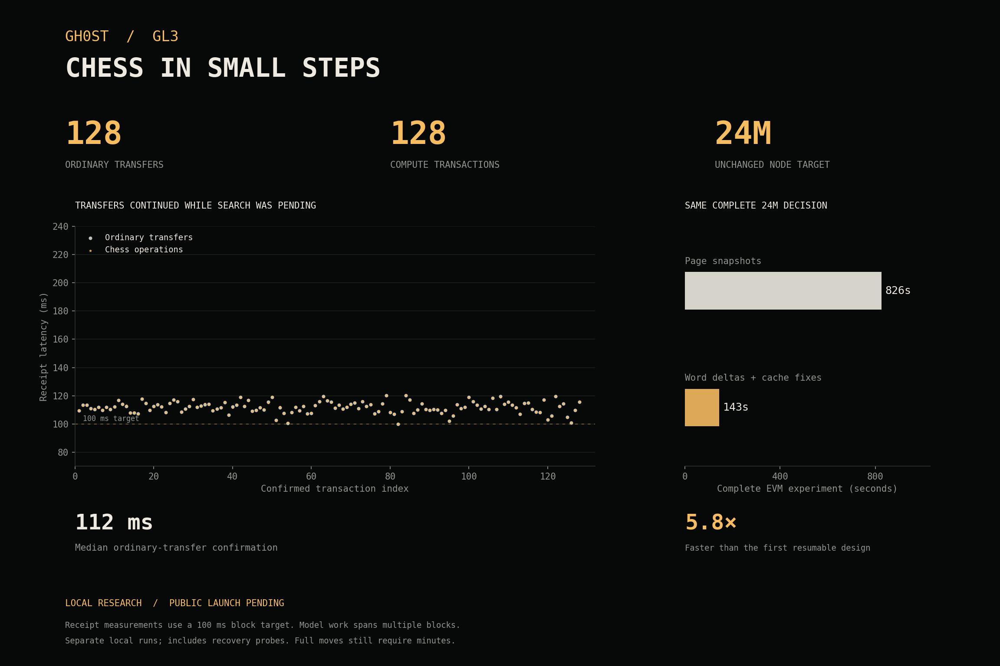
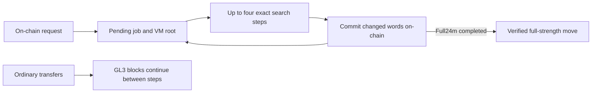

# Chess without a single blocking search

**The corrected build passes a complete 24m decision, exact gas equality and fresh replay of two consecutive blocks.** This lane is **not deployed**; complete WAVM proof execution and production acceptance remain gates.

The full pinned Stockfish19 network, Hash128 MiB, one worker, skill20 and retained per-game state stay unchanged. The internal scheduling quantum is2,048 nodes. One transaction groups up to four exact continuation steps; neither setting reduces the24,000,000-node target. An unfinished search has no playable result. No external engine result is accepted.

Binaryen Asyncify turns the recursive search into a portable continuation. Its spill stack, engine stack, heap and mutable Wasm globals belong to the durable job state. Restoring a fresh instance must produce the same move, actual node count, depth and all163,085,439 canonical retained-state bytes as the monolithic reference.

## Acceptance gates

- [x] Isolated continuation module builds without modifying the old full-replay run.
- [x] Two consecutive complete 24m searches match exact canonical checkpoints, with both scalar and accelerated portable modules.
- [x] A fresh instance resumes suspended recursion with identical results.
- [x] Actual local GL3 blocks commit bounded operations while 128 independent transfers receive receipts during a pending search.
- [x] Actual EVM retry, rollback, generation/cursor guards and restart checks pass; debug-mode corruption checks pass.
- [ ] Matching direct Wasm replay and Solidity proof witnesses pass.
- [ ] Measured cadence, storage growth and move latency fit the selected host.

The100 ms base block target is a measurement goal. Short engine calls alone do not prove it: snapshot persistence, model initialization, completion and cold recovery also need to fit. No latency or hosting claim is promoted before those costs are measured.

## Measured progress

Both complete decisions retain the monolithic policy exactly: `e7e5 /24,000,033 /depth38`, then `b8c6 /24,000,311 /depth39`. Their complete canonical checkpoints match byte for byte. The scalar continuation took319/322s locally; SIMD128 reduced that to about55/58s, including deliberate instance destruction/restoration. These are engine-only experiments, not total mined-move latency.

The first snapshot implementation completed a full actual EVM decision in825.86s across9,853 individual continuation calls. Replacing full dirty-page writes with authenticated32-byte word deltas, batching shared Merkle ancestors and grouping four continuations reduced the complete EVM experiment to206.73s across2,464 operations. Its canonical checkpoint is still exactly`5f9762c73c1309824a365e47f936d27975c6233770672803bcc6ffbba30f28c6`. This is roughly4x faster than the first resumable implementation, not faster than the original monolithic native search.

At one operation per100ms block,2,464 operations imply a floor of about246s, roughly4.1min, before additional overhead. The earlier one-step-per-block approach implied16.4min. Actual mined move latency is not established by these dispatch experiments.

[Scalar full-policy parity](evidence/scalar-full24m-parity.json) · [Accelerated full-policy parity](evidence/simd-full24m-parity.json) · [Accelerated dirty-page screen](evidence/simd-dirty-cost.json).

[Complete original snapshot EVM experiment](evidence/evm-full-snapshot-v1.json) · [Complete word-delta EVM decision](evidence/evm-word-delta-full.json) · [Final admission/RPC/release regression](evidence/evm-final-api-prefix.json).

The real EVM tests persist the portable VM image through a committed genesis image and immutable, hash-checked word deltas. A fresh VM resumes from chain bytes. One-gas-short failure rolls back the whole trie. A global compute slot permits at most one computing operation per block. The synchronous A13 ABI is absent from the sliced node profile. The local mining fixture also caps block gas so two full compute calls cannot fit even if an outer contract reverts their state writes.

The research service admits one retained game through the project chain-owner account. This prevents free jobs from evicting the active VM or exceeding its memory reservation. Releasing a pending game publishes no partial result and allows a fresh game to reserve capacity. Paid public gameplay needs a separately authorized game coordinator; this is not a permissionless funded chess launch.

## Sealed state and replay

The full network is part of the pinned program and committed initial VM image. Native execution uses Wazero's compiler; the Wasm proof target uses its deterministic interpreter. Host calls to clocks, files, network or an engine oracle trap. The same program and state image determine both paths.

The normal profile enables the reviewed research extension A14 directly while disabling **all standard development-only precompiles**. In particular, ArbDebug's arbitrary code-overwrite method must be disabled. Under that sealed-page invariant, a cached VM may be reused only under its exact authenticated image root; a missing cache reconstructs and verifies the complete image from authoritative pages. Debug-enabled experiments instead sweep every cached page identity. The public profile, cache-invalidation induction, replay equivalence and resource bounds remain review gates; enabling arbitrary debug writes invalidates the fast-path assumption.

RPC simulations use an isolated VM and a separate one-request admission limit. They cannot advance or evict the live replicated search, and their computed next root matched the subsequent real transition. Their admission and cache behavior do not change replicated arithmetic or gas results.

Cold reconstruction took roughly0.6–0.8s at the measured early fixtures. The full word-delta run's warm dispatch median was76.8ms, p95112.5ms and maximum352.1ms while other research jobs ran locally. Its timed rows wrote about1.616GB of delta payload, excluding genesis, first operation and a recovery probe. Long-history recovery, pruning, total game storage and24GB hosting acceptance remain production gates. The lane has moved no real funds.

## Actual mixed-traffic blocks

With the100ms sequencer target,128 computing transactions and127 independent transfers received real local receipts while the full-strength search remained pending. Chess receipt latency was123.2ms median /169.4ms p95; ordinary transfers were123.1ms median /160.7ms p95. The observed maximum was214.2ms, with a separate905ms cold first step. These are transaction-confirmation measurements, not a100ms inference claim or hosted SLA.

The fixture explicitly used14m max transaction gas,15m max block gas and a150m-gas/s research pricing target. ArbDebug was disabled. A recorded engine-bearing block was posted in a real local parent batch. Independent native replay, without the node or database, reproduced its complete expected block hash, send root and inbox position in5.59s. The complete WAVM replay is running separately; it is not yet counted as passed.

[Actual receipts and configuration](evidence/mixed-traffic-blocks.json) · [Independent replay](evidence/native-sliced-block-replay.json) · [Pinned replay machine](evidence/sliced-machine-build.json) · [Compiler/interpreter state parity](evidence/compiler-interpreter-parity.json).

SIMD headers are fetched by exact URL and SHA from Emscripten4.0.20 using [compat-lock.json](compat-lock.json). The inherited [Emscripten license](../../../chess/engine/LICENSE-EMSCRIPTEN.txt) and Stockfish GPL notices apply.

## Cache correctness repair

The R23 cold first block replayed correctly, but consecutive-block testing exposed two bugs. A warm invocation skipped19,200 gas of seed-metadata reads, and a recorder using that warm VM omitted dependencies from its proof input. The second input shrank from roughly362MiB to94KiB; a fresh replay produced the wrong end block hash. The earlier timings remain historical measurements, not evidence that those bugs were absent.

The corrected loader charges the same seed reads with or without a cache. Both paths now use exactly12,320,567 gas for the tested operation and produce the identical VM root. Recording, replay and prefetch use a fresh isolated VM outside the live-cache lock, sharing a bounded memory reservation with RPC simulation. Recording always touches all state needed by a fresh prover. These changes preserve the engine program SHA, complete network,24m target and retained game state.

The corrected full EVM experiment completed in143.22s and matched the entire canonical checkpoint. Its actual mixed-traffic run confirmed128 compute transactions and128 ordinary transfers: transfer median111.8ms / p95119.0ms, maximum120.3ms. Two independently recorded consecutive blocks now both reproduce all expected global-state fields in separate fresh native replay processes. The latest module root is`0x52c7d494becea047cd0ba0ed288a96f39544056ef573ff961f8268d5b43fa4e5`.

[Reproduced failures](evidence/cache-regressions-before.json) · [Exact gas equality](evidence/cache-metering-fixed.json) · [Corrected API tests](evidence/cachefix-api.json) · [Complete24m decision](evidence/cachefix-full24m.json) · [Mixed traffic](evidence/cachefix-mixed-traffic.json) · [Fresh first block](evidence/cachefix-first-native-replay.json) · [Fresh next block](evidence/cachefix-next-native-replay.json).

The still-running WAVM experiment belongs to the frozen R23 cold-first-block artifact. Its eventual result must retain that scope and cannot certify the corrected module above. Source/build variants keep both sets of artifacts separate.

## Proof execution experiment

The [scalar AOT proof lane](aot/README.md) removes the embedded interpreter from a separately named proof build. Complete native24m translation parity and scalar Wasm state/error checks pass, and the upstream WAVM loader accepts its machine. Complete corrected-block replay is running. This remains an isolated experiment; neither public deployment nor a measured proof-speed improvement is claimed yet.
