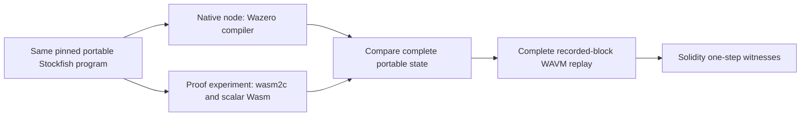

# Faster proofs, the same chess engine

**Experimental and isolated.** The default node still uses the tested Wazero
backend. This directory investigates removing a second interpreter from the
proof path; it does not reduce the search budget or accept an external answer.



The program SHA remains
`1d650410655d93624801a0fa45d64d72ec5d209115672b5848f010037da5e5bc`.
The full98,511,183-byte NNUE,24m nodes, Hash128 MiB, one worker, skill20,
retained TT/history and exact integer operations are unchanged. Standard
SIMD operations in the portable program are translated through pinned SIMDe
code to scalar instructions for the proof machine. There is no quantization
or substitute model.

The native translated experiment has reproduced the complete decision
`e7e5 /24,000,033 /depth38`, including every163,085,439 canonical retained-state
byte. Fresh resumes at engine steps4,4000 and9850 also matched every byte of the
466,157,568-byte portable image and all three mutable globals. These checks
establish translation parity at the measured points; they do not certify a
new replay machine or prove a latency improvement.

The Wasm companion has a separate error-unwinding layer. Engine traps must
return an error to the EVM, just as they do under Wazero. Fatal machine errors
in place of EVM reverts would be a consensus bug. The outer unwind state is
private to the companion; the inner portable engine image remains authoritative.
The proof bridge is private to the Go replay module, with checked lengths and
internally allocated VM handles. It is not a new public EVM entry point.

| Acceptance gate | Status |
| --- | --- |
| Pin complete source VM and translator archive | Passed |
| Complete native24m decision and canonical checkpoint | Passed |
| Fresh native C resumes, all image bytes/globals | Passed |
| Scalar proof Wasm resumes and recoverable errors | Passed |
| Frozen eager snapshot: complete recorded-block WAVM replay | Passed |
| Frozen eager snapshot: five distinct Solidity witnesses and corruptions | Passed |
| Host memory, long-history recovery and sustained block cadence | Pending |

Reproduce from the repository root:

```sh
python3 research/gl3/chess/sliced/aot/build.py
research/chess/engine/.cache/venv/bin/python research/gl3/chess/sliced/aot/test_parity.py
python3 research/gl3/chess/sliced/aot/build_proof.py
research/chess/engine/.cache/venv/bin/python research/gl3/chess/sliced/aot/test_proof.py
```

Only after those gates pass, prepare a separately named replay experiment:

```sh
python3 research/gl3/chess/build_replay.py --sliced --variant aot --aot-proof
```

This flag cannot modify the frozen R23 artifacts or the corrected cachefix
machine. The Go proof overlay is created in its own cache directory; native
node builds keep the original backend. All generated code, model bytes and
toolchain files stay out of Git.

The [WABT1.0.42 source archive](https://github.com/WebAssembly/wabt/releases/tag/1.0.42)
is pinned by SHA256
`a76cda3c174a43097863a07fc0b0c202f770f53e21806ea2636f167d1ffb1e30`.
See the upstream [wasm2c documentation](https://github.com/WebAssembly/wabt/blob/1.0.42/wasm2c/README.md).
The archive includes SIMDe and its license. WABT's Apache2.0 license, SIMDe's
MIT license and the inherited Stockfish GPL notices apply. No public chain deployment has occurred. A disposable Runpod CPU test server is now billable; no real chain funds have moved.

[Native translation parity](evidence/native-parity.json) · [Scalar proof-Wasm parity and error checks](evidence/proof-parity.json)

The SDK memory helpers also needed MVP implementations: the pinned verifier rejects bulk-memory instructions. All870 alignment, overlap and fill tests pass, and the final scalar companion repeats the same all-byte and error checks. The first trap-unwinding prototype failed on an invalid operation; removing unreachable-only compiler assumptions from the private proof runtime fixed that case. These compatibility changes do not modify Stockfish or the default node.


## Complete replay and the next optimization

The frozen eager snapshot at module root
`0x67c7f0be4295e764e9c34fbc06d428715032becca45452f8ee02461c32db2f42`
finished a complete corrected engine-bearing block and matched all four expected
global-state fields. It emitted 3,097 witnesses, with a final step interval of
309.5–309.6 billion, below the standard one-step-verifier envelope. Five distinct
sampled steps pass the pinned Solidity verifier; corrupted prestates and witnesses
reject. This is a complete **first-operation block**, not an entire 24m-move WAVM
run or a complete BoLD dispute.

That replay took 2,455.83 seconds locally. This is proof-generation time, not
mined move latency. Uniform step samples put 1,916 of 3,096 locations (61.9%) in
Go's generic SHA-256 block routine; those are instruction samples, not a CPU
wall-time profile. Hashing and cold reconstruction remain substantial costs.

A newer lazy mirror copies engine memory only when the block requests it. The
real Go/Wasm wrapper and unchanged scalar companion match the eager wrapper's
full-image hashes, globals and progress at steps 4 and 8, and both reject illegal
history. It removes three of four full-memory transfers per computing operation:
1,398,472,704 fewer copied bytes, with the same search work. That is a **75% cut in
step-copy traffic**, not a claim of 4x faster proofs.

The newer machine root is
`0xd45324627b0b3118dfdf1ad585769024cfa6008da8cdcaa745de32edc724613b`.
Its own full replay is still required. The completed older-root test cannot
certify this later change. A disposable Runpod CPU server is being used for a
paired Linux replay of both roots against the same captured input. CPU generation
5, 16 vCPUs and 32 GB RAM were quoted by the live catalog at $0.56/hour, excluding
scratch storage. No GPU is used; the engine and proof runner remain unchanged.

[Completed WAVM block](evidence/complete-wavm-block.json) ·
[Solidity results](evidence/complete-solidity-steps.json) ·
[Selected witnesses](evidence/complete-selected-proofs.json) ·
[Sample distribution](evidence/sampled-profile.json) ·
[Go/Wasm mirror parity](evidence/wrapper-parity.json) ·
[Newer machine build](evidence/lazy-machine-build.json)

Worst-case rejection/resource equivalence, long-history recovery, pruning and
acceptance on the selected production host remain required before launch.
