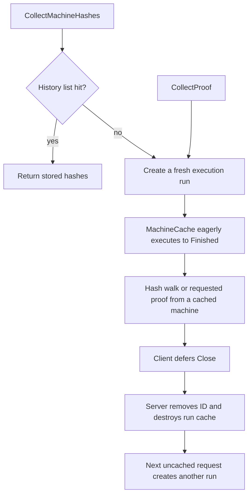

# BoLD execution-run reuse: source review

**The default compiled provider does not retain an execution run across hash-list
and one-step-proof requests. A fresh lifecycle cannot assume that the completed
150-minute CLI replay, or the previous request's machine snapshots, will be
reused.** This is a read-only review; no cache enhancement or new replay ran.

Inspection used the pinned source in
`/root/future-lifecycle-865-geometry43-build/nitro`. The [source inventory](source-inventory.json)
and line references accompany this report. The earlier unlaunched execution-cache prototype
is not evidence of implemented or measured reuse.

## What is cached

| Layer | Identity / lifetime | What survives a later request |
| --- | --- | --- |
| Generic machine loader | Resolved Wasm module root; loader's in-memory map | Immutable zero-step and until-host-I/O templates. It does not retain a block's completed execution or its input-specific snapshots. |
| ExecServer | Random/incrementing execution ID, not an input/module lookup key | A run remains while that ID is alive and accessed. A new `createExecutionRun` always allocates a new ID/run. |
| Per-run MachineCache | One run's input-loaded machine and host cache configuration | Sparse frozen machines, final machine and a last-used mutable machine, until this run is closed/destroyed. |
| History commitment cache | Rollup block hash + Wasm root + message number + `StepHeights` | Lists of 32-byte hashes on disk. A hit can avoid recomputing that same history list; it is not a resumable machine or a one-step-proof cache. |
| Preimage resolver references | Context ID shared by clones of one loaded machine | Keeps that run's input resolver alive until all referring clones are destroyed. It is not a cross-input execution-run reference count. |

`CollectMachineHashes` checks the history cache, otherwise constructs the real
validation input and calls the BOLD execution client. `CollectProof` constructs
the input and calls the same client directly. Different challenge levels normally
have different `StepHeights`, and a proof request does not hit the history-list
cache.

The current history-list key does not independently include `stepSize`, complete
input bytes or challenge geometry. It assumes the surrounding canonical chain
and fixed geometry identify the requested history. A changed-geometry research
run should use its fresh cache directory; old cache files are not evidence of
correct new-level histories.

## Exact lifecycle and replay work

`BOLDExecutionClient.GetMachineHashesWithStepSize` and `GetProofAt` each call
`CreateExecutionRun(..., true)` and immediately install `defer execRun.Close()`.
There is no shared-run map in that client. `ExecutionClientRun.Close` stops its
keepalive loop and asynchronously sends `closeExec`; the server deletes the ID
and calls the native run's `Close`. Native `Close` stops/waits for its threads and
destroys its MachineCache asynchronously, once only.

The default MachineCache targets four snapshots, initially 100,000 steps apart.
Its constructor starts a background loop that advances snapshots, discards every
other one and doubles the spacing **until the machine stops**. The build lock is
not released before that loop finishes. Consequently even a request for a small
position waits for this eager full execution under the default implementation.

After this initial build, `machineHashesWithStepSize` obtains a machine at the
requested start and steps that local machine through the requested intervals.
For a collection starting at zero that extends to halt, this can be another full
walk after the eager cache-build walk. Later levels/proofs may also replay a
prefix from the nearest retained sparse snapshot. The current CLI's measured
150.18 minutes is not a timing measurement of these API paths, their sparse
snapshot overhead or their repeated walks. A four-hour lifecycle bound is
therefore **unproven**, even if a shared-run adapter prevents subsequent fresh
initializations.

The actual geometry43 fixture overrides the cache target to **two** snapshots and
the execution-run idle timeout to **four hours** (`gl3_terminal_fixture_test.go`
107–108). Those settings do not replace the fresh-run/deferred-Close client
behavior or provide cross-request retention. The four-hour idle timeout is not
itself a four-hour end-to-end runtime measurement.

`PrepareRange` is an existing API that can rebuild snapshots around a narrower
interval within an already retained run. The default BOLD client methods above
do not call it. It cannot resurrect a run after Close, and it does not by itself
establish a measured lifecycle time or memory bound.

## Lifetime, concurrency and key requirements

An authentic existing ExecutionRun can serve multiple sequential queries if its
owner keeps it alive. That uses the normal machine/proof implementation and
does not change the engine, guest, verifier or module root. The default provider
does not manage that lifetime across requests, so this requires a host adapter
or cache enhancement before it can be claimed.

A proposed enhancement would need all of the following before a full launch:

- Key the **decoded validated typed input**, explicit resolved module root and
  `useBoldMachine` flag. Reorgs, changed preimages, batch/delayed messages, user
  Wasm bytes, start state or other typed fields must not borrow a different
  execution. A message number or root alone is insufficient.
- Use the transport preflight's canonical typed-input digest as a reviewed
  starting point, not raw JSON wire SHA. Pinned `PreimagesMapJson.MarshalJSON`
  ranges over a Go map, so equivalent requests can have different JSON order.
  The proposed digest sorts map keys and length-prefixes items, but presently has
  only the actual fixture's client/server equality test. Map-order invariance,
  every-field mutation, wrong-root/flag and structural group-boundary tests are
  still required before treating it as a general cache identity.
- Hold an immutable owned input or otherwise enforce that the bytes cannot
  change after their identity is calculated. The native resolver captures the
  input's preimage maps; clone reference counts keep those maps alive.
- Distinguish borrower Close from final underlying Close, with explicit bounded
  retention, lease counts, cancellation/eviction rules and cleanup after the
  challenge. One borrower must not cancel another active query.
- Serialize mutating queries on a shared run, or prove correct cloning per
  query. MachineCache's last-machine slot and hash walk exchange mutable machine
  objects outside the build lock. Per-machine Step/Hash mutexes do not make an
  entire multi-step hash query atomic against another query.
- Preserve real keepalive/timeout behavior. The default server timeout is
  15 minutes, refreshed by accesses; client keepalive normally runs every minute
  and CheckAlive every ten seconds. Retaining only an idle server ID without
  those client duties is insufficient for a 150-minute execution.
- Measure both latency and memory. Keeping four or more authentic snapshots
  can have a different peak from the completed single CLI process. This review
  authorizes neither a snapshot-count increase nor a memory/capacity claim.

The canonical typed-input helper inspected is `gl3TypedInputIdentity` in the
transport v3 fixture, source SHA256
`2f731c53cce007742690ea61d9bcf8203a9d64320aada2b9e28eb8bab018b298`.
Its actual fixture digest was
`d0e345814249c0825732665eb5745d9b1b1480d086887e1b67fa7955dac0aeca`
for 402,818 preimages. The module root and BoLD flag were checked separately in
that transport test; they must also be separate components of any reuse key.
`ExpectedEndState` is capture/output-acceptance metadata rather than a field of
decoded `validator.ValidationInput`; it must still be checked by the consumer
when deciding whether execution matches a claim.

Destroy explicitly releases the zero/final/sparse-cache machines. Its helper
does not explicitly clear the separate `lastMachine` field; that object's later
Go/C finalizer lifetime should not be described as synchronized immediate memory
release. No leak or reclamation timing was measured in this source-only review.

## Source map

| Pinned source | Relevant lines |
| --- | --- |
| `staker/bold/bold_state_provider.go` | 382–459: history lookup and uncached hash call; 519–580: proof call |
| `staker/challenge-cache/cache.go` | 65–72: key; 99–163: hash files; 265–281: hierarchy |
| `validator/client/validation_client.go` | 148–165: new remote ID; 190–211: fresh run and deferred Close per request; 216–269: liveness; 322–330: asynchronous close |
| `validator/valnode/validation_api.go` | 62–122: ID map/create/timeout; 141–152: access refresh; 219–231: delete/close |
| `validator/server_arb/execution_run.go` | 29–46: cache/lifetime; 92–169: local hash walk; 172–179: proof query |
| `validator/server_arb/machine_cache.go` | 38–95: default/eager build; 99–119: destroy; 142–197: range rebuild; 268–290: closest/last-machine query |
| `validator/server_common/machine_loader.go` | 24–65: module-root template map |
| `validator/server_arb/machine_loader.go` | 23–54: zero/host-I/O templates |
| `validator/server_arb/validator_spawner.go` | 39–44: timeout; 115–126: input resolver; 227–253: new input-loaded run |
| `validator/server_arb/machine.go` | 64–105: resolver release/finalizer; 134–150: clone reference increment |
| `util/jsonapi/preimages.go` | 23–62: custom unsorted JSON map encoding |
| `validator/server_api/json.go` | 62–74,124–178: wire fields and validated decoded input |
| `validator/validation_entry.go` | 18–28: complete decoded typed-input fields |

The completed terminal CLI proof, all frozen machine/input artifacts and previous
evidence remain unchanged. Transparent reuse is feasible using real execution
objects, but the missing cross-request lifecycle and the repeated-work profile
need a tested, measured host-only change before claiming the full lifecycle will
fit four hours. No implementation or lifecycle launch is authorized by this
review.
