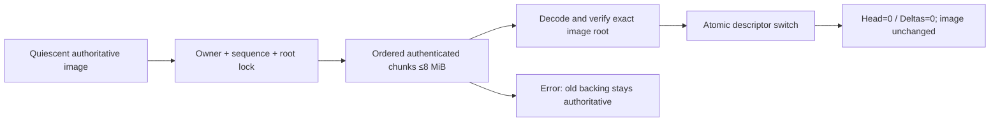

# GL3 · isolated checkpoint prototype

[Storage study](../checkpoint-study/README.md) · [Current test result](evidence/final-53/result.json) · [Actual exits](evidence/final-53/prototype-tests-exit.json) · [Exact tested sources](evidence/final-53/source-manifest.json)

**53 named tests/subtests pass on Runpod.** This implements the verified standalone bitmap codec and an isolated transaction-state prototype. It does **not** modify or install a current native/guest/STF profile. No engine, game, block or public transaction ran during these checks.

The authenticated preterminal fixture preserves **all 466,157,568 memory bytes and every exported global**, round-tripping into a **145,871,930-byte** versioned encoding. The state-transition tests separately use explicitly synthetic completed snapshots; the real captured image remains labeled **preterminal**, not a completed decision. [Exact real-image result](evidence/final-53/frozen-codec-result.json).

## Implemented behavior

| Component | Concrete behavior |
| --- | --- |
| Full-image bitmap codec | Fixed-genesis differences, complete memory length and globals; changed-to-zero words retained; module/genesis/image identities verified |
| Strict decoding | Bounds lengths/counts, checks the exact exported-global identities, rejects redundant changed words, missing/trailing data and root mismatches |
| Existing incremental tree | The pinned `Tree` algorithm is copied unchanged; no new Merkle construction or search-state reset |
| Authenticated blob boundary | Emulates the existing SHA-256 body, 16 KiB code fragments and ten-byte prefix/length format; verifies every read and body hash |
| Bounded append envelope | Each body is **at most 8 MiB**, below the existing 32 MiB blob maximum; ordered build ID/index/length; a partial last piece seals the append stream |
| Build authority | One admitted active game; owner, generation, sequence, expected root and non-reusable build nonce checks; unfinished searches and initial generation cannot start a completed-decision build |
| Build lock | Search admission, release and another build reject while checkpoint construction is active |
| Atomic verified switch | Validate all bytes/globals and the captured image root before installing a descriptor and resetting only storage `Head/Deltas` |
| Warm cache | Preserve the exact cached image pointer; update only its backing-manifest identity/epoch so old backing identities cannot silently persist |
| Cold restore | Require the authoritative manifest identity, correct fixed genesis and ordered authenticated pieces; restore memory/globals plus generation/sequence/history/request metadata |
| Rollback and cancellation | Injected partial writes and outer-transaction reverts restore journaled state; cancellation preserves committed partial blobs for a separately reviewed retirement policy |

`Begin → Append* → Finalize` is guarded by a frozen game/root/sequence/history/request identity. Finalization changes the backing descriptor, storage ancestry and cache backing identity; it preserves the VM image, globals, generation and history. A stale/corrupt/incomplete build leaves the previous head authoritative. The cold-restored synthetic state can admit a next search without clearing retained bytes; this is **search admission**, not a measured next engine decision.

## Evidence and boundaries

The final native Go test run exited **0** in **5.52 seconds**, with four CPU-affinity slots and sampled process-tree RSS about **2.21 GB**. This time covers the isolated test suite, not game/move latency, block execution or gas. The frozen image was independently extracted from the recorded preimages without invoking a VM/engine. The earlier extraction receipts and initial 48-case prototype remain preserved separately. [Final receipt](evidence/final-53/prototype-tests-exit.json), [initial extraction](evidence/initial-48/fixture-extraction-exit.json), [initial source/result](evidence/initial-48/result.json).

Tests cover all-byte/global equality, zero transitions, memory growth, corruption/absence/extra data, owner/stale/root/generation/nonce failures, single-game admission, build locks, partial-write rollback, canceled-build replay, missing/corrupt pieces, stale history metadata, outer rollback, untrusted self-consistent manifests, wrong genesis, chunk-index binding, and multiple append bodies within the 8 MiB cap. Source hashes and actual exits identify the exact tested revision.

### The production integration still required

The authenticated store here is an **emulator of the existing blob wire/layout rules**. It does not create Geth accounts, derive the real Keccak addresses, meter gas, use the live `StateDB` journal or alter native mint/backing behavior. A thin reviewed Nitro adapter must delegate these operations to the existing real authenticated blob storage and transaction context. The harness's owner values and authoritative-snapshot backend are test inputs, not a production ABI for accepting user-supplied engine state.

`StreamBuild` is a synchronous test convenience. Although each `Append` is size-bounded, **`Finalize` currently performs a full native decode/root verification**. Neither helper is a bounded, gas-metered production method. A real STF integration still needs scheduled authenticated build/verification work, bounded final switch, metering parity, reorg/recording tests and a matching native/guest machine. The existing incremental tree must remain intact.

No actual completed engine decision was checkpointed and continued to the next frozen golden canonical result in this task. That native integration, full guest replay/proofs and block-time/resource acceptance remain open. The current native/guest engine and search policy are unchanged because this prototype is separate.

**Cleanup is deliberately absent.** No committed blob accounts are deleted; global sharing/refcounts, resurrection, funded accounts/nonces, fixed reusable banks, physical pruning and challenge-safe historical availability remain separate gates. Transaction rollback in the emulator only undoes uncommitted writes. No 20-game capacity or mainnet readiness is established.

## Reproduce on Runpod only

Stage this module and `run-linux.py` in a fresh `/root/gl3-checkpoint-prototype/<revision>/` directory, then run that script on the existing Linux worker. It uses at most four CPU-affinity slots, an isolated build cache, read-only module resolution and separate evidence directories. The frozen extractor only reads `/root/bounded-restore` artifacts. Later source-only test revisions may reuse a prior isolated fixture, with all bytes/root rechecked by the mandatory named test. Nothing is uploaded into the current STF/native/guest trees. The Go tests refuse execution on the Mac.
