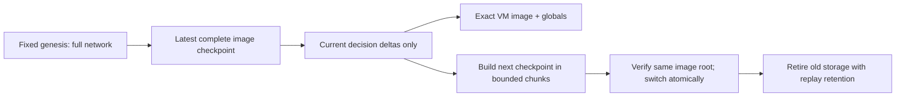

# GL3 · bounded checkpoint study

[Acceptance notebook](../../README.md) · [Exact measurements](evidence/measurement.json) · [Pinned source identities](source-snapshot/manifest.json) · [Repository comparison](repo-comparison.json)

**Recommendation: checkpoint the complete portable image against the fixed genesis, then retire obsolete storage incrementally.** Resetting storage ancestry must preserve every VM byte and exported global, including the full TT and history. Keep the existing incremental Merkle tree. A hard account-count bound also needs reusable storage addresses; code clearing alone cannot remove accounts that somebody has funded.

This is source analysis and an **offline, authenticated preterminal measurement**, not an implemented STF change or a production acceptance result. No engine, VM instance, search, block production or pruner ran. No current source, frozen input, chain database or running fixture was modified. All measurement/build execution ran on the existing Runpod worker.

## What was actually measured

The frozen first-decision input contains the state at **block 4916**, immediately before the final computing transaction. The study restored all **2,463** linked deltas from its recorded trie/code preimages and checked both the genesis and authoritative image commitments. No saved final portable-image/canonical byte file existed: the earlier completed native audit retained only its final size/hash/root. Consequently these numbers are **not measured final-decision checkpoint sizes**.

| Representation | Body bytes | Hypothetical 16 KiB code accounts¹ | Gzip level 1 body bytes² |
| --- | ---: | ---: | ---: |
| Existing 2,463 delta bodies | **1,617,877,668** | **99,982 actual accounts** | Not measured |
| Full portable memory image | 466,157,568 | 28,453 | 285,958,377 |
| Changed 4 KiB pages against genesis | 159,637,600 | 9,744 | 85,042,608 |
| Changed 32-byte words with individual offsets | 162,057,168 | 9,892 | 97,686,373 |
| Word-selection bitmap + changed word values | 145,871,744 | 8,904 | **84,482,760** |
| Contiguous changed-word runs | **145,783,320** | **8,898** | 85,382,668 |

¹ Proposed account counts include an **illustrative 237-byte descriptor**, divide into 16 KiB payloads and exclude trie/metadata/index/retirement overhead. No checkpoint accounts were created. Existing delta code actually occupies **1,618,877,488 bytes** including its ten-byte chunk headers. The shared genesis has **71,823 code accounts**, which remain required and are excluded from the proposed account savings.

² Cheap streaming archive-compression measurements, not an implemented consensus codec or gas benchmark. The raw bitmap body was written to a new private study file and decoded with bounded buffers; **every reconstructed image byte matched**, and all three globals were retained in the report. Word-run encoding is the smallest raw format tested, not a proof of a globally optimal encoding. Its raw advantage over the bitmap is only 88,424 bytes; the bitmap compresses better here.

There are 4,501,588 changed words, 38,936 changed pages and 216,563 contiguous runs. The authoritative preterminal image root is `1df5de9ee735983c5d096ac026cde106c3407fb2960b63ad90c36cf4edea4ccf`. Its entire memory SHA-256 is `3cab2f8a2133c5b762a1744a290a8f5db150209e7c706adf9374d66b7ece3446`. The original final canonical checkpoint remains a separate earlier result, not the byte source of this measurement.

Build exit was **0** in 1.61 seconds; measurement exit was **0** in 18.66 seconds. The study used two CPU-affinity slots and peaked at **1,801,408,512 bytes sampled process-tree RSS**, below its 2 GiB stop threshold. Sampling was every 0.2 seconds, not a hard cgroup memory measurement. [Build receipt](evidence/build-exit.json), [measurement receipt](evidence/measurement-exit.json), [exact tested scripts](evidence/source-manifest.json).

## Why history currently grows

`sliceCommit` appends a GSD1 body containing the previous head, memory length and sorted changed 32-byte words. `sliceWriteDelta` stores its 16 KiB fragments as code at globally content-addressed accounts. Metadata increments `Head/Deltas`; beginning the next search does not reset them. Cold restore starts from genesis and walks **all** ancestors to zero, applying the newest value of each word. `ReleaseGame` clears admission/cache state but leaves the immutable blob accounts and historical metadata. [Commit and release](source-snapshot/nitro/precompiles/ArbGhostChessSlices.go#L233), [delta writes and ancestry](source-snapshot/nitro/precompiles/ArbGhostChessSliceDelta.go#L21).

The cloud `ArbGhostChessSlices.go`, history validator and runtime match the repository copies exactly. The delta reader differs only by the reviewed optional uncached historical-code accessor. [Comparison](repo-comparison.json). The existing `Tree.SetLeaf/Flush/Root` already merges dirty-page ancestors incrementally; a new Merkle design is unnecessary. [Exact tree implementation](source-snapshot/chess/sliced/runtime/runtime.go#L272).

## Concrete format and state transition

Use a versioned checkpoint that is **standalone relative to the fixed genesis**, never relative to an earlier checkpoint. Its descriptor binds module identity, genesis image root, complete memory length, all exported globals, exact image root, codec/version and a bounded chunk manifest. Keep game generation, request/history and progress in authoritative metadata. A canonical TT/history export alone is insufficient: the current image commitment and cold restore also bind the rest of linear memory and globals.

For an initial implementation, prefer the simple bitmap decoder; optionally select runs when its **deterministically calculated raw length** is smaller, with one explicit tie-break rule and strict increasing/nonoverlapping bounds. Preserve changed words whose value became zero. Keep archive gzip separate until a consensus decompressor's worst-case gas, guest memory and proof behavior are tested. A roughly 146 MB checkpoint exceeds the current **32 MiB single-blob limit**, so use a streaming chunk manifest rather than raising that allocation limit and reading one enormous blob.

Build the checkpoint over bounded maintenance transactions after `Pending=false`, preserving ordinary block availability. Freeze that completed generation during construction. Until all chunks and the image root verify, the previous head remains authoritative. Finalization atomically installs the checkpoint, sets **storage** `Head=0/Deltas=0`, and preserves the entire VM image, game history, progress and image root. The next decision starts a fresh delta chain; cold restore becomes **genesis → checkpoint → current decision**. Memory growth is zero-extended before deltas, with the existing length/global/root checks retained.

Refresh or invalidate the cache's backing-code identities at the switch: its current key is only the image root, which intentionally stays unchanged. A cache cannot retain old `Codes` identities after those accounts are retired. Warm/cold/recorded paths also need equal metering; no timing or gas saving is established by this byte-size study.

This caps ancestry across completed decisions, not the first decision's own delta accumulation. It therefore does not repair or accept the existing first-decision guest proof. More frequent checkpoints could preserve an exact suspended image too, but their scheduling and write/proof overhead are a separate unmeasured design.

## Safe incremental cleanup, including the account trap

The measured delta accounts all have **nonce 0 and balance 0**. Their writer calls `SetCode`, without setting a nonce. In the pinned Geth, `SetCode(address,nil)` sets an empty code hash; normal `Finalise(deleteEmptyObjects=true)` removes an account only when nonce, balance and code are empty. This is a viable code-clearing path for these measured accounts, subject to full transaction/revert tests. It is not an unconditional account-deletion API. [SetCode](source-snapshot/nitro/go-ethereum/core/state/statedb.go#L568), [empty predicate](source-snapshot/nitro/go-ethereum/core/state/state_object.go#L93), [finalization](source-snapshot/nitro/go-ethereum/core/state/statedb.go#L922).

A retirement cursor must first authenticate a blob's prefix/hash/length and record its prior head and fragment count, then clear only a bounded number of owned fragments per transaction. Preserve progress atomically across reverts/restarts and charge every read/write. Never clear the shared genesis or an account containing unexpected code. Addresses are global content hashes: identical histories can share blobs, so a zero-reference check and resurrection/retirement guard are required before clearing them.

**Donated balances and nonzero nonces must be preserved.** They prevent empty-account deletion even after code is cleared. Do not reset a nonce, burn/redirect balances or invoke an old account's `SelfDestruct` merely to meet a storage target. The pinned StateDB method can directly mark an object for destruction; it is not evidence that protocol-level EIP-6780 safeguards or balance disposition have been honored. This means content-addressed writes plus cleanup cannot guarantee a hard public account-count bound.

For that stronger bound, use **fixed reusable checkpoint banks and a reusable current-decision blob ring**, under the existing single-active-game reservation. Explicit slot/epoch ownership replaces cross-job content sharing; later code overwrites preserve existing nonce/balance, and old code versions remain historical database data. Two checkpoint banks allow verified build-and-switch without overwriting the active image. A reviewed admission/storage limit must bound ring size; its worst-case full-strength workload remains unmeasured. This is a future storage-format change, not something installed by this study.

## Current state, disk space and historical proofs are different

The pinned offline pruner supports the **hash-based scheme** and constructs a bloom filter from selected retained roots plus genesis. It marks nonempty code hashes reachable from those roots, then deletes other trie/code keys and compacts the database. Thus it cannot reclaim blobs still present in current state; after logical code clearing, historical code can remain necessary for protected roots. Ordinary compaction alone does not establish either live-account removal or historical-code reclamation. False positives can also retain extra data. [Pruner configuration](source-snapshot/nitro/go-ethereum/core/state/pruner/pruner.go#L90), [code marking](source-snapshot/nitro/go-ethereum/core/state/pruner/pruner.go#L395), [deletion](source-snapshot/nitro/go-ethereum/core/state/pruner/pruner.go#L218), [explicit retained roots/genesis](source-snapshot/nitro/go-ethereum/core/state/pruner/pruner.go#L493). **No pruner was run.** Path-based storage needs its own retention review; the hash pruner is not a generic live-server cleanup command.

Logical STF retirement can remove obsolete accounts from the newest state while older roots retain their original code. Physical pruning is a separate operator step. Retain all dependencies needed by unresolved assertions/challenges, reorg/restart recovery and the selected confirmation policy. Keeping only the newest checkpoint root can destroy intermediate-state proof availability. A precise numeric horizon cannot be selected before finality settings and dispute/recovery response budgets are accepted.

Archive packages should bind checkpoint descriptors, code chunks, module/seed identities, relevant parent batches and the trie/code preimages needed for the retained replay intervals. Hash-check and restore them independently before pruning, pin open disputes, and keep an independent copy. A confirmed checkpoint alone does not supply the preceding execution trace or prove that old replay data remains available. Untrusted object storage can cache historical bytes; it is not an on-chain authority or a substitute for reviewed parent data availability. The current model/current checkpoint remain authenticated chain state.

## Archive cost boundary

Official rates checked **17 November 2026**: Backblaze B2 lists **$6.95/TB-month**, with egress up to three times average stored data included, then $0.01/GB; its page distinguishes remaining Class D charges. Cloudflare R2 Standard lists **$0.015/GB-month**, $4.50/million Class A and $0.36/million Class B operations, with no direct egress charge. Ignore free tiers when budgeting an already-used account. [B2 pricing](https://www.backblaze.com/cloud-storage/pricing), [R2 pricing](https://developers.cloudflare.com/r2/pricing/).

| Stored archive volume, before free tiers/tax/operations | B2 storage/month | R2 Standard storage/month |
| --- | ---: | ---: |
| 100 decimal GB | $0.695 | $1.50 |
| 1 decimal TB | $6.95 | $15.00 |

These are storage-rate examples, not an order, availability guarantee or full GL3 hosting quote. Pack preimages into indexed chunks instead of one request per account. Budget **shared genesis + retained checkpoints + current and challenge-window deltas + trie/replay inputs + independent replicas**, plus retrieval/recovery service and request costs. The 84.48 MB compressed bitmap is only one preterminal image body; it is not a complete historical proof archive.

No 20-game capacity is accepted. Current-state checkpoint savings, historical retention length, real later-game checkpoint sizes, cleanup throughput, hard account limits and cold proof memory must be measured together. The existing full engine/search policy is unchanged; this packet implements none of the proposed STF or pruning changes.
