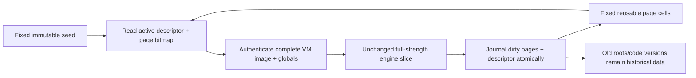

# GL3 · retention without changing the chess engine

[Source index](source-index.json) · [Required acceptance tests](ACCEPTANCE.md) · [Earlier storage study](../checkpoint-study/README.md) · [Current A15 experiment](../checkpoint-integration/)

**Design only. No storage format is changed, no accounts are cleared and no pruner is run.** The smallest sound route to a hard current-state bound under one active game is a **fixed reusable page bank**, with every engine byte and global preserved. Logical storage bounds and historical disk retention require separate acceptance. Neither 20 games, 1 TB nor a $100/month deployment is accepted here.

## The existing constraint

Current A14 writes immutable GSD1 fragments at addresses derived from the complete body hash. Each new delta links to its predecessor; cold restoration walks the entire chain. Release marks metadata and frees admission/cache state, without deleting the blob accounts. A15's current checkpoint switch replaces the storage head/count but also leaves the old code in current state. [Writer and reader](../checkpoint-study/source-snapshot/nitro/precompiles/ArbGhostChessSliceDelta.go#L24), [release](../checkpoint-study/source-snapshot/nitro/precompiles/ArbGhostChessSlices.go#L316), [A15 switch](../checkpoint-integration/core.go.txt).

The authenticated **preterminal** first-decision study found 2,463 delta bodies totaling 1,617,877,668 bytes in 99,982 code accounts. The standalone bitmap prototype encodes that same image in 145,871,930 bytes. These are different representations. The inspected A15 handler emits GSD1 offset/value records; the earlier study's analogous single-body word-record estimate was 162,057,168 bytes, before multi-piece overhead. An actual A15 write total requires its own receipt. None of those measurements is a complete game's storage total. [Measured fixture](../checkpoint-study/evidence/measurement.json), [bitmap round trip](../checkpoint-prototype/evidence/final-53/frozen-codec-result.json).

There are two independent growth mechanisms:

| Layer | What accumulates | What bounds it |
| --- | --- | --- |
| Current state | Reachable accounts, code references and metadata slots at the newest root | Fixed address/slot set, or authenticated retirement; plain checkpoint compaction does neither |
| Retained disk | Old code hashes, trie versions, block/batch inputs, witnesses, archives and database overhead | An accepted historical-root policy, demonstrated rebuild/archive availability and separately reviewed physical pruning |

`SetCode` changes an account's referenced code hash. Raw code storage is keyed by **code hash**, not account address; replacing an account's code therefore does not remove the old bytes from the database. Ordinary database compaction is not a reachability policy. [StateDB write](../checkpoint-study/source-snapshot/nitro/go-ethereum/core/state/statedb.go#L568), [raw code read/write/delete](../checkpoint-study/source-snapshot/nitro/go-ethereum/core/rawdb/accessors_state.go#L49).

## Reuse the earlier work; keep its limits visible

Fixed pages are not a new chess or snapshot algorithm. The original full dirty-page persistence experiment recorded a full native/local EVM decision over 9,853 continuation calls, with the same final canonical hash; its documented time was 825.86 seconds. Word deltas, shared tree updates and four-step grouping later reduced the documented experiment to 206.73 seconds over 2,464 operations. The old direct-page handler's exact source revision was not located in the inspected committed history; its saved result does not certify a new bank or an updated implementation. [Original page experiment](../../../chess/sliced/evidence/evm-full-snapshot-v1.json), [word-delta experiment](../../../chess/sliced/evidence/evm-word-delta-full.json), [historical comparison](../../../chess/sliced/README.md).

**Eager/lazy means a different optimization: Go↔C engine-memory mirroring.** Frozen eager module `67c7…2f42` passed an earlier first-operation recorded block and five sampled Solidity witnesses. During the later paired Linux trial, eager exited −9 after 2,309.71 seconds and the aggregate 64 GB cgroup recorded an OOM kill; lazy module `d453…613b` passed that same first-operation input in 2,712.72 seconds. The shared cgroup peak is not a per-process attribution, and that trial did not complete a whole 24m-node move or a BoLD dispute. The lazy wrapper removes three of four full-image transfers per group; a fixed page bank should retain that wrapper, not return to eager copying. [Frozen eager block](../../../chess/sliced/aot/evidence/complete-wavm-block.json), [failed paired trial](../../evidence/cloud-baseline-comparison-failed.json), [lazy trial](../../evidence/cloud-first-lazy.json), [wrapper parity](../../../chess/sliced/aot/evidence/wrapper-parity.json).

The current uncached readers and collection scheduling address retained immutable seed/history bytes and guest heap pressure. They do not establish that mutable page-cell writes are correct, that eager copying is cheap, or that the old aggregate host OOM is fixed. Mutable cells must initially use ordinary StateDB reads and journaled writes, rather than silently entering an accessor explicitly restricted to immutable restoration. Selected root `8651…f086` and every future bank-profile root remain separate identities. [Uncached scope](../checkpoint-study/source-snapshot/nitro/precompiles/ArbGhostChessSliceDelta.go#L58), [selected scheduling work](../../production/bounded-restore/scheduling/README.md).

## Choice: one reusable page bank

The steady-state minimum needs one bank because each computing operation is already one atomic EVM transaction. A second bank is useful for a separately scheduled migration/build, not required for ordinary dirty-page updates. Preserve the existing page hash tree and complete image semantics.

| Option | Benefit | Extra condition or limitation |
| --- | --- | --- |
| Retire current immutable hashes | Least storage-reader disruption | Global sharing/resurrection bookkeeping; funded/nonzero-nonce account residue defeats a strict account-count bound |
| Two checkpoint banks plus a delta ring | Keeps compact append records for normal slices | Ring must never wrap into live dependencies; needs a proven decision bound or exact suspended-image checkpoints during a pending search |
| **One fixed dirty-page bank** | Bounds live storage throughout an arbitrarily long search and across jobs | New mutable-cell format; page writes, cold reads, gas and proof costs must be measured |

A finite delta ring that merely refuses when full cannot promise unchanged full-strength availability. The engine might need more operations before finishing. To retain append deltas safely, checkpoint the exact suspended VM at a deterministic threshold, including pending continuation/control state, full TT/history and globals; then atomically retire the ring's dependency range. Current A15 rejects checkpointing while `Pending=true`, so it cannot supply that guarantee unchanged. A ring therefore adds work beyond this minimum design.

### Fixed authoritative layout

Use a new explicitly versioned profile; do not change A14/A15 formats in place.

* `Cell(bank, pageIndex)` derives from a new fixed domain and protocol bank ID, **not** owner, job, generation, content hash or epoch. Otherwise each new job/epoch creates another unbounded account set.
* One global active descriptor stores profile/module/seed identity, monotonically increasing game epoch, owner/job identifier, operation/generation/search metadata, complete memory length, exported globals and exact image root. Reuse its fixed storage slots. Persist historical user-facing results as events/receipts or another explicitly budgeted structure, not an unbounded live per-job map.
* A fixed-size presence bitmap identifies pages overridden against the immutable seed; bitmap groups carry an epoch tag so a new game can logically start empty without an unbounded initialization transaction. At most 196,608 pages means 24,576 bitmap bytes, before bounded epoch-group metadata. These are proposed layout bounds, not gas measurements.
* Each referenced cell contains STOP-prefixed, versioned bytes binding profile, bank, active epoch, page index and exact page encoding. Start with the existing simple full-page/zero-page semantics. A later canonical per-page bitmap encoding is optional and requires its own decoder/gas proof.
* Code writes are exclusive to the versioned STF. Reject unexpected pre-existing code or wrong ownership headers. Keep ordinary arbitrary-code debug writers disabled. If fixed accounts are reserved/pre-created, any nonce initialization is a separate reviewed migration; never decrease a pre-existing nonce.

The single-game admission slot, heavy-operation budget and RPC/observer admission lease must be shared with the other enabled chess profiles. A distinct page address domain alone does not prevent two profiles from consuming the same physical compute capacity.

### Exact operation and reset

Before computation, authenticate the active descriptor and needed cells. Cold reconstruction reads the fixed seed and active-epoch overrides, validates each present cell, and checks the existing full image/global commitment. Absence is accepted only where the authoritative bitmap says to use the seed/zero-extension; a missing referenced page is an error. An override whose value became zero must still override a nonzero seed page. Memory growth is zero-extended and bounded by the unchanged runtime limit.

Run the identical engine program, NNUE, node budget, hash allocation, worker count and retained state. Feed dirty pages to the existing incremental tree. Journal each changed page's code and presence metadata, then the new descriptor/root and operation counter within the same transaction. A page equal to the seed can clear its presence bit; its unused cell may retain old bytes because the finite address set already supplies the current-state bound. Resetting a game changes the active epoch and metadata, never discards TT/history during a continuing game. A new game's initialization policy remains the existing policy.

`SetCode` preserves account nonce, balance and ordinary storage. Do not call `SetBalance(0)`, reset a nonce, use `SelfDestruct`, transfer donations away or otherwise manufacture account emptiness. Donated funds/nonces may remain permanently at bank addresses; a fixed finite address set makes this bounded rather than treating those values as garbage to burn. The bound covers protocol-owned cells and metadata only, not arbitrary public-chain accounts. [Empty-account predicate](../checkpoint-study/source-snapshot/nitro/go-ethereum/core/state/state_object.go#L93), [finalization](../checkpoint-study/source-snapshot/nitro/go-ethereum/core/state/statedb.go#L922).

### Rollback, reorg and native cache

The descriptor, cell writes, bitmap groups, operation budget and epoch must all use real StateDB journaling. A trap, one-gas-short failure, outer contract revert or process crash before commit must expose either the old complete image or the new complete image, never a partial mix. Same-block repeated writes, snapshots, copies and reorgs must preserve the correct prior code bytes and authenticated witness dependencies.

A native VM is an accelerator. Bind it to exact profile/chain/genesis, epoch, owner/job, authoritative backing/bitmap identity and image root. An image root alone is inadequate when backing changes without changing image bytes. Close/delete stale native VMs before reconstructing; a stale code-identity map must cause authenticated cold reconstruction rather than make an otherwise valid cold state revert. Invalidate before advancing a live engine and never publish an advanced VM under the old descriptor. Recording/RPC/prefetch paths must reconstruct from the proper StateDB view and retain their lease until VM use and Close finish.

The A15 source follow-up now hashes its builder's exact source and piece prefix, and closes/deletes then authenticates cold state when cache identities drift. That is a useful pattern, not acceptance of mutable banks. The existing optional-reader tests cover dirty SetCode, journaling, snapshot/revert and copies narrowly; the new complete bank transition needs the real-handler tests listed separately. [Current A15 source](../checkpoint-integration/core.go.txt), [StateDB regression evidence](../../production/bounded-restore/ethereum-state-regression/).

## If immutable retirement is chosen instead

Authenticate a retired root, body hash, prefix, size, predecessor and complete fragment list before clearing bounded fragments. Account ownership is not private: current A14 hashes are global and identical bodies can be shared across jobs, A14/A15 and partially built checkpoints. Register authoritative live-root/build references and prevent a zero-reference retirement from racing reattachment/resurrection. Historical references belong to the separate disk-availability policy below; never confuse a zero current reference with a deletable historical code hash.

Retirement progress, global references and any tombstone/epoch must be journaled. Never clear genesis, active/build heads, a blob with another current reference, unexpected code, or an address inferred solely from an untrusted retirement request. Validate and retain its predecessor before clearing a header needed for continued traversal. Canceling a build does not automatically retire its already committed partial pieces.

For observed zero-nonce/zero-balance accounts, clearing code may allow normal empty-account finalization. Funded/nonzero-nonce accounts must survive; this means finite old-account residue remains even after all owned code is safely cleared. Fixed new banks cannot retroactively remove existing A14/A15 blobs. A migration has a separately bounded legacy backlog and its own retirement/availability review. **No cleanup is authorized or executed by this document.**

## Rough bounds, not a hosting result

The unchanged runtime's 768 MiB memory ceiling and 4 KiB pages give at most **196,608 page cells per bank**. Under an illustrative header cap of 128 bytes, a full-page cell cap is 4,224 bytes, or **830,472,192 bytes per bank**. Two banks would double that. These are arithmetic code-payload envelopes, excluding seed, trie nodes, account overhead, metadata, balances/storage, legacy backlog, database amplification and all historical data. They are not measured disk sizes or accepted configuration limits.

At the measured preterminal state, only 38,936 pages differ from the fixed genesis; a full-page encoding with that same illustrative header would occupy about 164 MB in those cells. A later position could change every page. The existing shared genesis already has 71,823 nonzero code accounts; it must remain available, and a profile upgrade must not repeatedly allocate another copy without counting it.

One bank plus fixed metadata bounds **current protocol storage** across sequential jobs, even if no game finishes. It does not bound total transaction history or old unique code versions. As an illustration only, repeating the first-decision 1.6 GB delta write scale across 20 games × 80 Black decisions would exceed 2.5 TB before trie/replica overhead. That is not a forecast of later positions or the bank design; it shows why a small current checkpoint is insufficient evidence for a 1 TB disk. Full-page writes may have different historical write amplification, which must be measured.

## Historical proof and rebuild availability

Overwriting a fixed cell is logically safe for older roots only while their old code hashes, trie nodes and replay inputs remain available. The pinned hash-scheme pruner marks code reachable from selected retained roots and genesis and removes other code/trie keys. It cannot infer open BoLD disputes, application challenge obligations, missing archives or an appropriate reorg horizon. No path-scheme or live-prune guarantee follows from that implementation. [Code marking](../checkpoint-study/source-snapshot/nitro/go-ethereum/core/state/pruner/pruner.go#L395), [root selection](../checkpoint-study/source-snapshot/nitro/go-ethereum/core/state/pruner/pruner.go#L503), [pruning](../checkpoint-study/source-snapshot/nitro/go-ethereum/core/state/pruner/pruner.go#L218).

Retain the union of dependencies for current/fallback checkpoints, unfinalized canonical and permitted reorg branches, all unresolved assertions and active challenge edges, configured recovery/restart windows, and any dispute response interval. Pin exact module versions, seed bytes, parent batches/delayed messages and their proofs, headers/receipts, start/end global states, code/trie preimages and terminal inputs. No numeric retention horizon is selected until actual finality/challenge configuration and recovery deadlines are reviewed.

Before any physical deletion, produce a hash-indexed archive manifest, verify every required byte, and demonstrate independent cold restore/replay from another durable copy. Code hashes can be shared across accounts/epochs/roots, so reachability must cover the whole retained root set, not one bank or one game's account list. Preserve an atomic archive-complete marker and repeatable recovery procedure across crashes. Parent chain data must actually make missing execution/genesis inputs reproducible; an assumption that everything can be regenerated is insufficient. The current authenticated seed/model cannot depend on an unavailable private initialization file.

An object store can hold verified historical copies without becoming an execution oracle. It does not provide canonical authority or automatically satisfy parent data availability, and one operator's saved snapshot does not prove challenger access. Keep at least one independently demonstrated recovery path and explicitly measured response time. Pruning, archive services and any financial operation remain separate reviewed actions.

The next step is the [acceptance matrix](ACCEPTANCE.md), starting with source/protocol design and narrow StateDB tests on Runpod. Nothing in this packet promotes the A15 experiment, selected865 replay, historical eager replay or 20-game hosting capacity.
