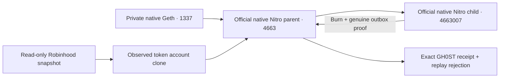

# GH0ST native-parent withdrawal parity

This separate cloud scenario exercises GH0ST custom-gas bridging on an **actual native Nitro parent**, rather than the adapted Ganache parent used by the preceding withdrawal test. The authoritative completion result is the exported `evidence/summary.json`; a transaction reaching the payout step alone does not pass the storage-witness gate.

**Passed on Runpod at 2026-11-16 22:22:47 UTC.** The fixed-endpoint witness covers 82 parent transactions through block 41, including 5 token-call transactions and 7 distinct token storage keys. All initial values match the frozen source; 6 previously uncopied mapping keys were independently confirmed zero. There are no unmatched keys or remaining owned chain processes. Five earlier failed attempts and their raw records are retained.

| Evidence | Result |
|---|---|
| [Summary](evidence/summary.json) | Complete fixture passed; all boundaries recorded |
| [Exact report](evidence/parent-parity-report.json) | Deposit 4 → spend 1 → burn/release 0.5 GH0ST; exact gas and payout accounting |
| [Storage witness](evidence/token-storage-witness.json) | All 82 committed parent transactions traced, mandatory token writes captured |
| [Source snapshot](evidence/source-snapshot.json) | Robinhood block 116103301; observed private post-transfer account clone |
| [Failures](evidence/failed-attempts.json) | Earlier failures preserved rather than overwritten |
| [Export manifest](evidence/manifest.json) | File hashes; private configs excluded; generated-key exclusion scan passed |

The private payout receipt is `0x3000abffbc5ad383023c6d71568a88d7a3067b299324aeccc5f8c3a554cc5543`. It is a disposable-cloud-chain receipt, not a mainnet explorer link. The transferred evidence archive is 277,248 bytes with SHA-256 `082e6749c5e9e5b4304305d4fe5e43b0eec106c9bdd6fcf70b02fabcb3bbc2a0`; the exact report SHA-256 is `0bd242e3dec6417a2b04b7d4486ebb5c96fa2085810ce6577372d1ac7bd4b8af`.

## What the fixture preserves

- GH0ST's actual runtime at `0x2eb2849cDE7957b86d0dFD4B59e450a9F9D15559`, its observed account nonce/balance and storage. Runtime Keccak-256: `0x7c38fa1b069b5e677034bab6219dd2f519f219f7637910131d9a0f58a05ae164`.
- A pinned read-only Robinhood source block. A private fork transfers 32 GH0ST from the public holder to an ephemeral signer; this changes no public balance. The observed post-transfer token storage is copied into the native parent's genesis. No token admin role is fabricated.
- Genuine native ArbSys and ArbGasInfo semantics on the parent. ArbSys's `0xfe` marker remains present; it is neither cleared nor replaced. Both native nodes must pass their own genesis-assertion check and match the independently computed genesis hash **and state root**.
- Official Nitro 3.12.2 native binary paired with the official `0xc10cd7ec6acaf1c441a3f6bd0900ad20f15855ba775a96f1939118cbc629dc97` machine. This fixture does not pair the custom chess A14 client with the standard machine.
- The upstream rollup/bridge/outbox contracts pinned to commit `4341b132cfbdcc980ead03765ca5224ff6cb5d97`, calldata posting and actual confirmed assertion registration. Native-parent transaction limits distinguish compute gas from poster/data fees.

## Acceptance gates

| Gate | Required result |
|---|---|
| Source provenance | Pinned source block remains consistent; exact runtime hash and observed source values recorded |
| Parent host | Actual native ArbSys reports chain 4663; no precompile override |
| Genesis | Parent and child computed hash/state root match, validation remains enabled |
| Role separation | Owner, unprivileged player and child batch poster use different ephemeral signers |
| Deposit | Player deposits exactly 4 GH0ST; child starts with no native allocation and credits exactly 4 |
| Child execution | Ordinary spend of 1, burn of 0.5, exact balance debit including actual gas |
| Batch binding | Actual SequencerInbox transaction identifies the batch end; no latest-head assumption |
| Withdrawal | Genuine outbox proof, real rollup confirmation, exact 0.5 recipient gain and bridge decrease |
| Rejections | Unconfirmed root, non-rollup registration, altered amount and repeated withdrawal revert |
| State coverage | Every committed parent transaction through a fixed endpoint is traced; all token storage dependencies match the frozen source or source-confirmed zero |
| Cleanup | All owned test-chain processes stop; generated signing keys stay out of exported evidence |

The token storage tracer follows CALL/STATICCALL and delegate-call storage contexts. It requires recorded writes in the funding, approval, deposit and payout transactions, checks every token SLOAD/SSTORE key against the **initial** observed source, and fails on an uncopied nonzero value. Native token calls into an uncovered external contract also fail. This prevents a sparse clone from accidentally passing by silently changing a relevant token flag or mapping.

## Honest boundaries

This is an **observed sparse account clone**, not the full canonical GH0ST ledger or an authenticated Merkle-proof reconstruction. All other token holders are absent except copied observed slots. Public metadata reads are pinned to the original Robinhood block because the auxiliary Ganache source fork rejects the token's dynamic-string getters; the actual native clone must reproduce those getter results.

The parent has explicitly fake ETH test allocations, and the root uses private development ETH. Confirmation uses a privileged fast confirmer, with a test history commitment; it does not demonstrate permissionless BoLD finality or the chess execution proof. A local unit-rate pricer is a fixture, not a market-price feed. This test is separate from the custom-client recovery, chess proof and dispute lanes. No public transaction, token movement, model search or engine-strength change occurs.

## Cloud-only reproduction

All preparation, compilation, chains, simulations, traces and evidence checks run on the assigned Runpod Linux worker under `/root/withdrawal-parent`. Local work is limited to editing, inspection and file transfers.

1. Transfer the pinned contract capsule, source adapters and `Reader4844.json` into the isolated worker directory. Supply the read-only prepared Geth/toolchain/native-library prerequisites described in `prepare-linux.py`.
2. Run `prepare-linux.py` on that worker. It verifies OCI layer digests and source archives, extracts the official node and machine, installs pinned Node dependencies, and builds a pristine genesis generator. A separate diagnostic driver adds only a print of the already computed genesis state root; upstream STF source remains unchanged.
3. Run `launch-cloud.py` on the worker. It checks syntax there, freezes the entire runner source tree for that attempt, and starts the scenario. Generated signers/configs remain private to that worker.
4. After a complete passing report and cleanup, run `export-cloud.py` on the worker. It retains earlier failures, exports exact frozen sources and traces, and scans every exported/decompressed file against all persisted generated signing keys before creating the archive.
5. Transfer the archive, verify its SHA-256 and publish only its reviewed evidence directory. Chain databases, private configs and signing keys are excluded.

`adapter-origins.json` records the original integration helpers. The copied adapters in this directory are intentionally independent of the shared integration source.
