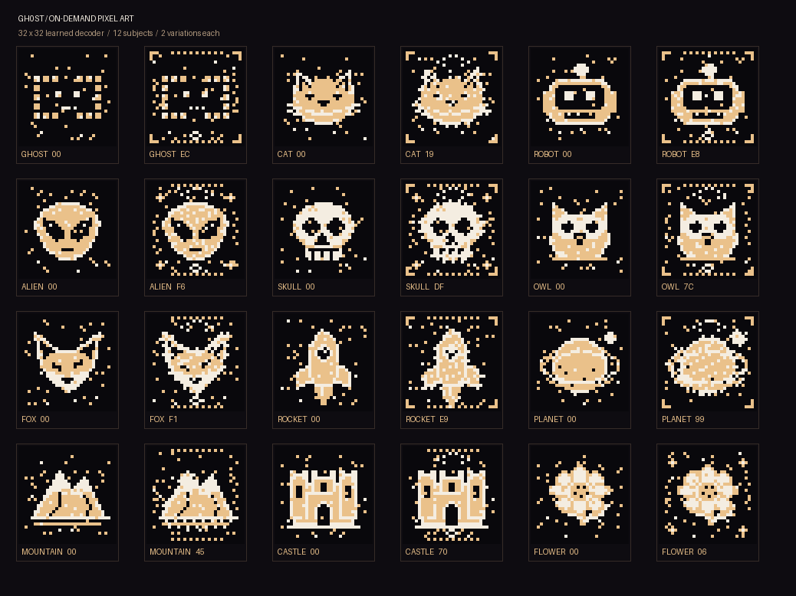

# GH0ST Image Studio

Generate 32×32 art on demand from a seed, a subject, and eight modifiers. The same contract works for profile pictures and standalone images. Try **a glowing cat with stars**, **a rocket with a frame**, or **mountain with an ivory halo**.

The prompt chooses the first supported subject and turns on matching modifiers. The full phrase hashes to a seed, and the form lets you adjust the subject and modifiers directly. The model supports Ghost, Cat, Robot, Alien, Skull, Owl, Fox, Rocket, Planet, Mountain, Castle and Flower. Generation operates within that vocabulary.



## What runs on GL3

The Solidity contract stores 19,662 bytes of immutable model data in its own data contract. The EVM computes all 1,024 pixels using a fixed-point projection and a trained subject head. Each request returns 256 packed bytes. The web client maps the prompt to input parameters and draws the output. A read-only preview has no user gas charge. `record` runs the same model and emits the image hash with the seed, subject and style.

- `generate(bytes16 seed, uint8 subject, uint8 style) returns (bytes)`
- `record(bytes16 seed, uint8 subject, uint8 style) returns (bytes32)`
- `modelHash() returns (bytes32)`

The exact baseline and thresholds used by the contract are the packed form of the trained decoder. The model training data comprises original labeled sprites. The [quality report](model/image-quality.json) matched 24,576 held-out images to their synthetic labels pixel for pixel. It also checks every modifier and proves 1,320,903,770,112 distinct combinations of output pixels over the reachable seed and modifier inputs across all subjects. The pixel comparison measures agreement with the synthetic art labels.

## Execution and costs

| Check | Result |
| --- | --- |
| Local contract execution | 72 bit-exact vectors, 24 successful `record` receipts and image hashes |
| Live GL3 RPC replay | All 12 subjects matched byte for byte on both endpoints at block 20,686 |
| Read-only preview | No user gas charge |
| GL3 `record` estimate | 224,534–228,311 gas, or 2.24534–2.28311 GH0ST across three measured inputs |
| GL3 one-transaction deployment estimate | 8,095,215 gas, or 80.95215 GH0ST at the measured block |

GL3 results are state-override simulations with the compiled runtime and exact weight bytes. They execute on live GL3 nodes without leaving state changes. The published studio configuration needs a mainnet contract address before visitors can request ordinary contract reads. [GL3 replay and estimates](bench/gl3-live-evidence.json) · [Isolated receipt measurements](contracts/anvil-benchmark.json)

## Reproduce

From this directory, install the pinned Solidity toolchain with `npm ci --prefix contracts`. With Foundry Anvil available, run:

```sh
node contracts/benchmark.cjs --override /tmp/gh0st-image-override.json
node bench/readonly-gl3.mjs /tmp/gh0st-image-override.json model/image-vectors.json /tmp/gh0st-image-gl3.json
```

The local benchmark starts an isolated Anvil node and writes the bytecode and constructor payload needed to repeat the GL3 read-only probe. Add `--keep-running` to leave the local node available. Its output prints the local RPC, test address, and model hash. To connect the browser studio locally, use those values in `site/deployment.json`, set `mode` to `local`, and serve `site/` over HTTP. Keep the local configuration out of source control.

`python3 model/train_image.py` regenerates the model and reference images using NumPy and Pillow. The expected pack SHA-256 is `5374de242d0df1b8b03e7937487d1dc3fd7d45f909e08e8874af17305838623a`.
