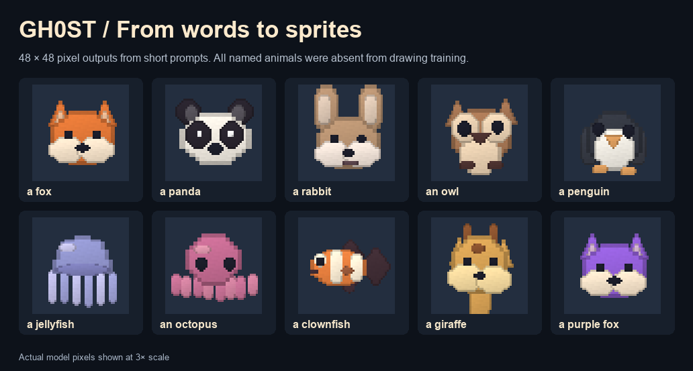

# GH0ST / Short-prompt sprites

An immutable 48×48 text-to-sprite model for Robinhood Chain. It resolves 100 supported animal names and appearance traits, predicts a drawing plan with a quantized neural network, then renders the pixels in Solidity. Generic synthetic layouts trained the planner. Named profiles were held out of drawing training.

The [frozen manifest](manifest.json) pins the seven model shards. [Robinhood simulations](robinhood.json) recorded 14 byte-exact generations at 4.85–5.83 million gas per image. [Appearance dictionary and references](LEXICON.md).

## Deployment preparation

A single atomic creation installs the seven shards, the matrix kernel, and the model contract. The [read-only preflight](deployment-estimate.json) estimated 10,981,470 gas at block 123,144,472, about 0.000230 ETH at the sampled price. The 49,035-byte deployment fit the 49,152-byte initcode limit and returned successfully in simulation. The [release verifier](verify-deployment.cjs) checks the eventual receipt, exact deployed runtime hashes, model configuration and output pixels before Image Studio activation.

This checkpoint records a deployment simulation and the pending wallet review.
