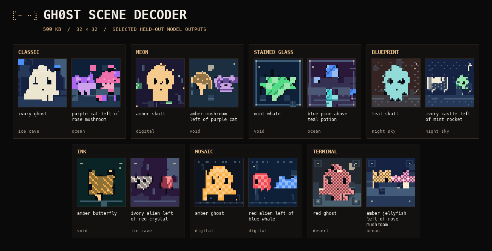

# GH0ST Scene Decoder · Trained 500 KB model

- [Quantized model pack](pack500.bin) · 500,000 bytes · SHA-256 `46d823ec0ad9585c4496ff75e22606a78041f724dd218d209083ad28de9658cd`
- [Sample gallery](model-samples.png) · 14 selected held-out model outputs at 32 × 32, enlarged for viewing
- [Packed images and prompts](vectors.json) · one single-subject and one two-subject example from each of seven styles
- [Supported prompt fields](vocabulary.json) · 24 subjects, eight tints, eight backgrounds, three layouts, seven styles and 16 palettes

## Training and image quality

The model trained on 28,672 original programmatically drawn scenes. The held-out set contains 896 prompts, including two-subject combinations excluded from training. These scenes share the original subject designs used in training. The frozen five-bit export matched **80.4% of all source palette indices** and **71.5% of source foreground indices** exactly. Background pixels contribute to the first figure. The gallery selects outputs by foreground-pixel agreement. These are pixel agreement measures and no human preference study was run. Some two-subject prompts still produce coarse or incomplete shapes.

The initial training pass reached about 3% exact foreground-pixel agreement. The final run used a larger training set, separate shade roles for each subject, and more emphasis on foreground patches. The on-chain renderer applies the requested tints to those roles. [Per-style metrics](training.json) and [training implementation](../train/).
