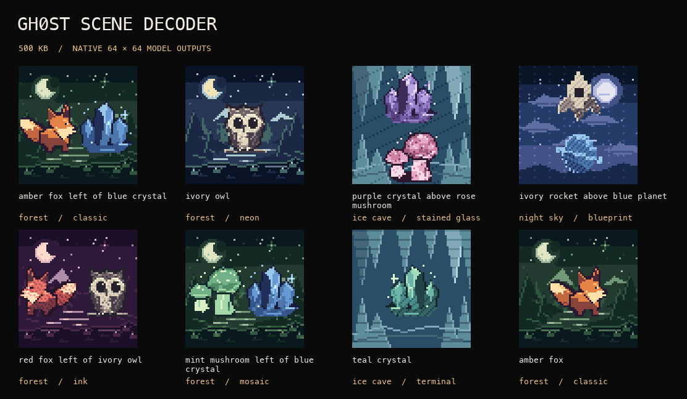

# GH0ST Scene Decoder · Native 64 × 64



[500 KB trained pack](evidence/pack500.bin) · [Exact image fixtures](evidence/vectors.json) · [Training results](evidence/training.json)

The 32 × 32 model lost detail when it selected an entire image patch at a time. This revision learns a 16-value representation of each tile and predicts the shade of every pixel. It generates two transparent subject layers and a background, then composes them on Robinhood Chain in the requested layout.

Prompts select from 24 subjects, eight backgrounds, seven visual styles, eight subject tints, and 16 backdrop palettes. The layouts are single, left/right, and above/below. Twelve subjects have a second learned form selected by seed. The training set adds four detailed native subject designs and eight layered backdrops, with shaded versions of the remaining original subjects.

Two learned five-bit decoder heads score eight shades per pixel. Both use exactly the same integer weights on the reference and on-chain paths. The classifier uses the first class in a tied score. The EVM composes 4,096 palette indices, applies the requested shade ramps, and returns 2,560 bytes of packed pixels and 128 palette bytes. The transaction function emits a hash of those exact bytes.

## Fixed model format

The pack is **500,000 bytes**, partitioned into seven 69,632-byte style shards and one 12,576-byte shared shard. All lengths exclude the one-byte STOP prefix used by the immutable storage contracts. Each style stores 24 base subject layers and 12 alternatives at 1,024 bytes per layer, followed by eight backgrounds at 4,096 bytes each. The shared shard contains the two packed classifier heads, palettes, the `GH0ST64B` format marker, and metadata. The constructor verifies the shard bytecode hashes and sizes.

Training fits the subject and background encodings independently on the source layers. The frozen export matched 99.39% of pixels across 252 source subject layers and 100% across 56 source background layers. The sample scenes are fresh compositions of those trained layers. The measured percentages describe reconstruction of the source artwork.

## Reproduce

Run with Python, PyTorch, NumPy, and Pillow. The model uses an Apple GPU by default. The same command accepts `--device cpu`.

```sh
python train.py --output evidence
node bench-rh.cjs evidence/pack500.bin evidence/vectors.json evidence/robinhood.json
```

The benchmark uses Robinhood's read-only RPC and compares every pixel and palette byte against the frozen model reference. It tests the transaction entry point with the image-hash event. Simulation accounts are temporary. Mainnet deployment remains pending.
