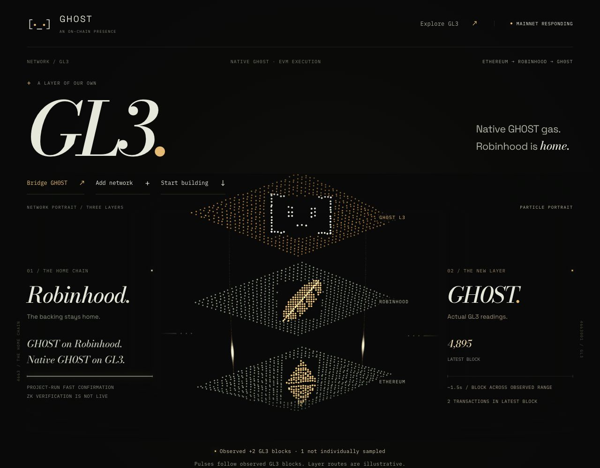

# GL3 · Whispers-style website release

[Open the live site](https://l3.gh0st.fyi/) · [Source](../../l3/) · [Publication receipt](live/publication.json)

The approved design reuses the exact live Whispers palette, CSS and font files. Its new particle portrait shows GH0ST, Robinhood and Ethereum as three interactive dot planes. Packets follow observed GL3 blocks; parent routes are illustrative.

| Release binding | Value |
| --- | --- |
| Production deployment | `6afccad23191f00013791e3b` |
| Published UTC | 2026-11-17 21:45:31 |
| Manifest SHA256 | `b7dae96ef796504c555af835808fe2e4c6651cf49998847ff58350971da3f3ff` |
| Final app SHA256 | `b61a2ffbfccbe3c3d66c7539317956357d42faba15d4bbaa6910a50bf0cb3d03` |

[Exact deployed files and manifest](stage-publish/) · [Theme provenance](theme-proof.json) · [Font inventory](font-inventory.json) · [Independent review](independent-review/README.md) · [Browser review](root-browser/review.json)

The saved CPU checks ran on Runpod. Browser observations cover actual graphics and controls; mocked fallback tests and announcement tests retain their narrower scope. Earlier failed screenshots remain dated evidence. The user approved the design and instructed immediate publication with no more QC. Further test/probe work stopped; the public page was opened only to present the delivered website. No post-publication QC campaign is claimed.
