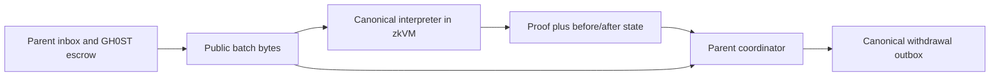

# GL3 · ZK rollup integration

**R55 · Canonical interpreter execution and scoped contract tests pass. Public mainnet is not deployed.**

The selected design preserves Nitro/ArbOS and Stylus execution, with `$GH0ST` as the child chain's native gas asset. A new zkVM guest must execute the canonical portable WAVM interpreter. The earlier ethrex EVM proof is a useful performance reference, but cannot authorize this chain's state or withdrawals.

| Workstream | Current evidence | Next acceptance gate |
| --- | --- | --- |
| State and data | 25 grouped registry/codec cases pass; 262-record range has constant-cost parent checking; coordinator compiles | Actual factory/bridge connection, guest agreement and proof-finalized transitions |
| Native GH0ST bridge | 35 scoped parent-contract checks pass, including real canonical accumulator codecs and transfer rollback | Real deposit → executed credit → proved withdrawal root → parent payout, with reconciled balances |
| Stylus execution | Linked portable guest actually executes canonical WAVM arithmetic in SP1 | Authenticated full machine, real Stylus execution and complete STF proof |
| Full LLM | Existing complete 3,745,984-parameter model retained | Real Stylus adapter and unchanged full inference inside a verified transition |
| Operations | One retained Runpod test worker | Restart, replay, data recovery, force inclusion and production security review |

## How finalization must work

The coordinator must check the exact previous state, chain/deployment domain, pinned guest key, machine/profile identity, and the data commitment authenticated by the registry. Only successful proof finalization may publish an outbox root. No administrative root setter or unproved timeout refund is part of the design.

[State and data envelope](STATEMENT.md) · [Registry source](contracts/GL3DataRegistry.sol) · [Stylus source audit](stylus/README.md) · [Bridge codec](bridge/canonical-codec.mjs)

[Measured contract tests](contracts/README.md) · [Interpreter execution packet](stylus/portable-probe/execution/manifest.json) · [Proof-stack advisory sources](PROOF-SECURITY-SOURCES.md).

## Boundaries

- All builds, execution, tests and proof generation run on Runpod. Local work is editing, static inspection, Git and evidence transfer.
- No new complete Stylus/STF/LLM proof or end-to-end ZK withdrawal is accepted yet. Typechecking and contract unit tests cannot establish those results.
- Preserve the existing model, arithmetic, weights, vocabulary and context. Chess remains deferred while the base chain is built.
- Nitro's applicable production licensing remains an unresolved launch requirement. Selecting ZK does not remove it or accept an agreement.
- Earlier private Nitro dispute/withdrawal tests and EVM-only proof timings remain historical scoped evidence; they are not acceptance for this new coordinator/guest.

See [sequential history](../HISTORY.md) and [the warm EVM reference](../zk-batch/warm-optimization/README.md). There is no defensible mainnet ETA until the real canonical guest executes and its proof cost is measured.
