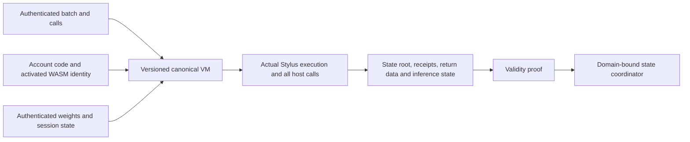

# Canonical execution and inference acceptance

The chain must select one versioned canonical VM configuration. It cannot accept an Ethereum-only post-state as interchangeable with an ArbOS/Stylus post-state merely because both proof systems verify.

## Statement and witness

The initial state-coordinator profile is explicitly ArbOS 61 without MEL. It binds all four bytes32 GlobalState fields but requires both MEL fields to be zero before and after execution. The guest must reject `GetEndParentChainBlockHash` unless an authenticated parent-context policy is added; this profile does not claim MEL support.

The public statement must bind chain ID, protocol/domain version, parent-chain settlement identity, previous accepted state root, next state root, batch hash and sequence, canonical VM/config hash, receipt/result commitment and withdrawal-root commitment. The model and inference result must be included in authenticated account/storage/code state or explicitly domain-bound commitments; they cannot be unauthenticated auxiliary claims.

Private witness data may include account/storage proofs, code, original WASM, model pages, prior session/KV state and compiler proofs. Each must be checked against the public or previously accepted state. A caller's expected checkpoint digest is not authority. In particular, `gh_accept_preverified_model` is valid only after the proved loader itself checks every weight byte against the immutable model identity; otherwise the ordinary `gh_seal_model` path must perform that check inside the proved execution.

The proposed coordinator codec is 23 static Solidity ABI words (736 bytes): version, domain, transition index, machine root, profile hash, pre-GlobalState, post-GlobalState and authenticated sequencer/delayed ranges and commitments. Each GlobalState contains four bytes32 values and two left-padded uint64 ABI words. This codec is a design, not an accepted new proof statement yet.

For each inbox type, require contiguous records with unique indices, exact canonical wire bytes and before/after accumulators. Recompute the same domain-separated rolling commitment inside the guest. Populate the VM inbox only from those validated records. Missing records must fail; the canonical machine's `TooFar` state is not an accepted successful transition. A zero-length read beyond the end of a supplied message is different from fabricating an absent message. Delayed read indices are independent from the sequencer cursor. Typed preimages require their own cryptographic key/data verification; this initial profile rejects unsupported blob/DAS/certificate paths.

For an AOT implementation, require a recursively verified compiler statement binding:

1. The authenticated original WASM/code hash and canonical module hash.
2. Stylus/ArbOS version, instrumentation, memory/stack and debug settings.
3. The compiler program verification key and exact compiled-artifact hash.
4. All executable bytes that the replay guest loads.

Do not accept an arbitrary map entry keyed by a claimed module hash as that relationship.

## Staged acceptance without narrowing the final requirement

1. **Target feasibility:** separately compile the chosen canonical runtime for the zkVM target. Record exact source, features, toolchain, guest ELF and verifier versions. Fail explicitly on unsupported imports or target assumptions; do not disable semantics to make it build.
2. **Actual Stylus semantics:** record an actual Nitro transaction calling the already activated tensor contract. Re-execute it with the candidate guest and compare real state root, receipt, status, output and metering. Then test storage writes/reverts, nested EVM↔Stylus calls, out-of-ink, memory bounds and activation. A kernel-only pass is a runtime milestone, not LLM completion.
3. **Full existing model:** provide a real Stylus ABI wrapper and authenticated model/session storage around the existing numerical runtime. Its raw module currently has neither a Stylus entrypoint nor a complete ordinary-contract persistence path. Keep every existing layer, attention head, weight, supported context and output logit.
4. **Complete inference:** execute at least one complete unchanged-model token position, retaining all KV/session state. Compare all 50,257 logits, next token and canonical checkpoint with the existing independent reference. The original first prompt token is 7454. Additional continuation/context tests must preserve the existing 64-token support rather than replace it with a one-token model.
5. **Genuine proof:** create a complete EVM-verifiable proof of that state/call/output transition. Verify it natively and with the pinned Solidity verifier; prove the public state/data bindings, not only an unrelated output hash.
6. **Negative tests:** alter model bytes, prompt/caller, contract code/WASM, module/AOT binding, prior checkpoint/KV, public result/state root and withdrawal commitment. Each must fail the appropriate execution/proof/coordinator gate. Test replayed sequence and duplicate settlement rejection.

Public activation, arbitrary Stylus contracts and full inference remain separate acceptance items. Any temporary preactivated-program-only profile must say so explicitly and cannot be presented as full Stylus compatibility.

## Scheduling and immutable evidence

All compilation, guest execution and proofs run on the existing Runpod worker. The measured EVM proof used about 41 GB sampled RSS, so only one heavy proof runs at a time. New target/toolchain experiments use isolated source/output paths and require coordination before starting. The existing guest, proof receipts and coordinator source stay frozen. No public deployment, key loading, spending or license acceptance is part of this packet.
