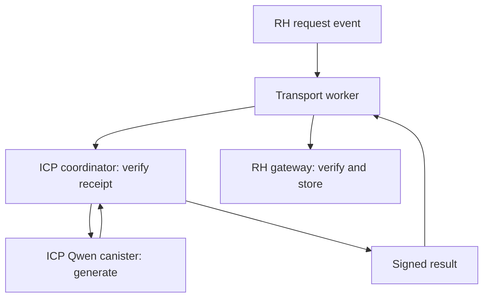

# GH0ST · RH → ICP → RH

An asynchronous Qwen3-1.7B inference bridge. An RH request is checked against two RPC providers, executed by a dedicated ICP model canister, and returned to RH with a threshold-ECDSA signature.

**Status: deployed and verified on 28 October 2026.** The retained-history repair is live on the existing coordinator and model canisters. A queued source completed generation, a canonical RH callback, an X post and proof reply, recorder capture, and a dashboard update. See the [repair record](docs/RETENTION-REPAIR-20261028.md) for exact artifacts and evidence; counts there are dated snapshots.

**Live route:** [GH0ST swap → ICP monologue → confirmed RH result → X post](SWAP-SOCIAL-AGENT.md). The worker observes registered existing v4 pools and submits their swap proofs. The coordinator applies the persona and confirmed-delivery memory; the authorized production worker publishes the confirmed result to X. Fresh installations still require their own deployment and account authorization.



## Implemented

| Component                                         | Behavior                                                                                                                           |
| ------------------------------------------------- | ---------------------------------------------------------------------------------------------------------------------------------- |
| [RH gateway](contracts/GH0STInferenceGateway.sol) | Authorized pilot requests, deadlines, cancellation, EIP-712 result verification, replay protection and answer events               |
| [ICP coordinator](coordinator/src/lib.rs)         | Two-provider receipt/state checks, one unfinished job, paginated retained history, stable upgrade state and threshold-ECDSA result signatures |
| [Worker](worker/main.mjs)                         | Confirmed-event polling, persisted queue, independent signature verification and optional RH callback submission                   |
| [Model lock](model-lock.json)                     | Exact upstream source revision, official GGUF revision/hash, non-thinking prompt format and generation settings                    |
| [Validation](VALIDATION.md)                       | Executed checks, limitations and next deployment checks                                                                            |
| [Deployment guide](DEPLOYMENT.md)                 | Build, install, model upload, signer binding and pilot launch sequence                                                             |

No training jobs or GitHub Actions are added. The worker schedules calls and transports results; inference runs inside the ICP model canister. It is not an inference server.

## Scope and trust

This is a cross-chain route, not inference executed by the RH EVM. A swap hook cannot synchronously wait for ICP. A later callback is a separate RH transaction.

The threshold key signs **the result attestation**. A relayer pays RH gas and signs the RH transaction. ICP does **not** construct/sign/broadcast its own RH transaction. Anyone may transport a valid result; an unavailable worker can be replaced without changing the gateway signer.

The signature commits to the request, prompt, model identifier, artifact manifest, answer, token counts and model-cycle measurement. Its EIP-712 domain binds the RH chain and gateway. RH verifies the configured signer; it does not independently prove every model operation. RPC providers supply source-chain facts, and ICP canister controllers remain part of the trust model. Keep their identities and any subsequent upgrades public. The model-Wasm hash is checked before measuring inference, but correct GGUF loading and settings must also be verified during deployment.

Requests and answers are public. The gateway stores the answer hash and emits the text; the coordinator retains the text. There are no model-selected external contract calls, wallet transfers or arbitrary execution hooks.

## Limits and cost measurement

- Admission permits one unfinished model job at a time. Completed and failed records no longer consume a lifetime admission quota: all historical jobs and replay protection remain retained. Production readers use pages of at most 32 jobs and 1,000,000 encoded Candid bytes. The legacy full-history query remains for compatibility.
- Prompt ≤4,096 bytes; answer transport ≤8,192 bytes. Persona swap candidates use ≤80 generated tokens, four per continuation call, and must pass the unchanged 30–180-character printable-ASCII output policy before signing. Manual requests retain their separate safety bounds.
- A dedicated model canister is required. The coordinator must be its controller to read cycle balances and invoke the model. Do not run unrelated requests, upgrades, top-ups or cleanup during a measurement.
- `model_cycles` is the model canister balance delta from before `new_chat` to the end of generation. It includes idle/storage burn in that interval. It excludes later cache cleanup, coordinator execution, RPC and signing charges.
- The deployed coordinator uses `model_cycle_budget = 0` for swap jobs: no per-job generation-cycle, chunk, or deadline ceiling. The **2 trillion cycles** checked by the worker are an admission reserve, not a hard execution budget or dollar-price guarantee. Funding floors and the existing funding policy remain in force. The production worker separately enforces a single-attempt policy: a rejected candidate is retained/deferred and the queue continues; it does not exercise the coordinator’s unlimited quality-retry capability.
- The coordinator makes eight bounded HTTPS outcalls per new request for two-provider chain/receipt/confirmation/state checks. An idle worker polls RH externally, so it does not create recurring ICP RPC charges while idle.
- For total cost, snapshot **both** canister balances around an isolated request, include cleanup and confirmation, and record RH receipt gas separately. Freeze external top-ups during the measurement. The earlier $0.60 allowance for a short 0.6B request does not price this longer 1.7B persona prompt and memory. The [verified repair thought](docs/RETENTION-REPAIR-20261028.md#verified-thought) recorded 1,602,979,391,152 model cycles; that is one observation, not a fixed price for future thoughts.

An interrupted model call is never silently repeated: its outcome may have committed before a response was lost. A failed job is retained for inspection. Signing retries use the already-fixed answer. Upgrades mark in-flight jobs failed; run upgrades only with no active request.

## Local checks

Node.js 22+ and Rust with the `wasm32-unknown-unknown` target:

```bash
cd rh-icp-inference
npm ci
mkdir -p build
cp deployments/retention-20261028/artifact-manifest.json build/artifact-manifest.json
npm run compile
npm test
node scripts/build-canister.mjs
npm run preflight
```

The Wasm build script runs Rust tests, builds the coordinator and embeds its generated Candid interface. This does not build the much larger upstream Qwen runtime. To inspect the deployed release without rebuilding it, use [the versioned artifacts](deployments/retention-20261028/). See [deployment](DEPLOYMENT.md) for a new installation and the [repair record](docs/RETENTION-REPAIR-20261028.md) for the existing deployment.

No signing secret, funded ICP identity or model weight file is included. Vendor files, private identities, state journals and local build outputs are ignored by Git. The explicitly versioned deployment artifacts contain public code and manifests only.

## Attribution

The model runtime is [onicai/llama_cpp_canister](https://github.com/onicai/llama_cpp_canister/tree/4276f526970b7916cc7105c357ad2f2ed018ed37), MIT licensed. Version `0.23.0rc4` includes the upstream Candid decoder security fix. The source model is [Qwen3-1.7B](https://huggingface.co/Qwen/Qwen3-1.7B), with the pinned [Unsloth Q4_K_M GGUF](https://huggingface.co/unsloth/Qwen3-1.7B-GGUF/tree/d7f544eead698dbd1f15126ef60b45a1e1933222), Apache-2.0 licensed. Preserve both upstream license notices when distributing builds or weights.

## Existing pools as the trigger

Set `WATCH_SWAPS=1` after configuring the same approved pools in the ICP coordinator and RH result gateway. The worker reads canonical `PoolManager.Swap` logs from existing pools. It does not change the pool, its hook or liquidity. Both the worker and ICP validate the full pool key and GH0ST membership; ICP independently checks receipts with two RPC providers.

Direct swap jobs use `submit_swap(transactionHash, logIndex)` and return via `fulfillSwapInference`. They need no extra RH request transaction: the existing swap and later RH callback are the two RH transactions in this route. Each source ID commits to the chain, manager, pool, transaction and log index. The gateway rejects repeated source IDs and accepts results only for enabled pools with the pinned signer.

[swap-sources.json](swap-sources.json) includes the recorded sentence-hook and Pons pool keys. These are saved deployment configurations, not fresh liquidity attestations. Enable only independently verified sources. Other venues need protocol-specific adapters or registration. The worker marks a result delivered only after confirming the canonical fulfillment event, its exact answer/hash and the configured confirmation depth.

## Swap-conditioned voice and delivery

[persona-profile.json](persona-profile.json) defines GH0ST's original voice and decoding settings. [Voice tuning](VOICE-TUNING.md) distinguishes actual local model outputs from human-written prompt examples and from live ICP execution. Verified buy/sell flow, remembered direction reversals and block rhythm shape the input; raw router addresses and token amounts are not repeated as a market report.

The source-derived seed changes with the swap, attempt and generated-token offset. The stateless printable-character grammar is compatible with resumed sampling, while output gates check length, finished phrasing, boilerplate and recent repetition before signing. The coordinator can prepare another candidate under its configured execution policy. The production worker instead retains and defers failures under its separate single-attempt policy and proceeds to the next queued buy. No stock text is substituted.

The two recent confirmed RH thoughts become character memory only after independent two-provider receipt verification through `remember_delivered`. Eight recent signed outputs are retained for repetition checks. The [X publisher](X-PUBLISHER.md) defaults to disabled in a fresh setup, verifies the intended account when enabled, and publishes only a confirmed RH thought. Production posts the exact text and Afterimage, then adds its proof reply. Older posted proof records can move to hashed archives with permanent deduplication; unfinished and ambiguous records stay in the active journal.
