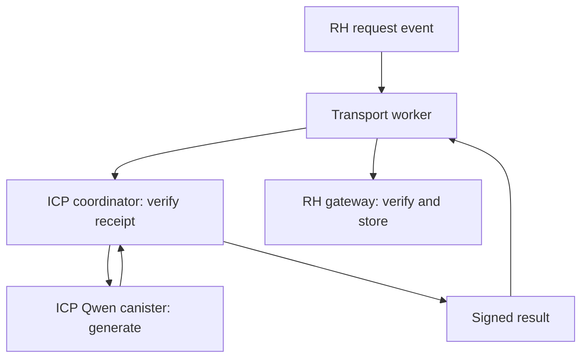

# GH0ST · RH → ICP → RH

An asynchronous Qwen3-0.6B inference bridge. An RH request is checked against two RPC providers, executed by a dedicated ICP model canister, and returned to RH with a threshold-ECDSA signature.

**Status: first implementation, locally tested; not deployed.** No ICP canister, loaded Qwen model, live cross-chain request or measured ICP price is claimed by this checkpoint. Existing GH0ST deployments are unaffected.



## Implemented

| Component                                         | Behavior                                                                                                                           |
| ------------------------------------------------- | ---------------------------------------------------------------------------------------------------------------------------------- |
| [RH gateway](contracts/GH0STInferenceGateway.sol) | Authorized pilot requests, deadlines, cancellation, EIP-712 result verification, replay protection and answer events               |
| [ICP coordinator](coordinator/src/lib.rs)         | Two-provider receipt/state checks, bounded model calls, resumable jobs, stable upgrade state and threshold-ECDSA result signatures |
| [Worker](worker/main.mjs)                         | Confirmed-event polling, persisted queue, independent signature verification and optional RH callback submission                   |
| [Model lock](model-lock.json)                     | Exact upstream source revision, official GGUF revision/hash, non-thinking prompt format and generation settings                    |
| [Validation](VALIDATION.md)                       | Executed checks, limitations and next deployment checks                                                                            |
| [Deployment guide](DEPLOYMENT.md)                 | Build, install, model upload, signer binding and pilot launch sequence                                                             |

No training jobs or GitHub Actions are added. The worker schedules calls and transports results; inference runs inside the ICP model canister. It is not an inference server.

## Scope and trust

This is a cross-chain route, not inference executed by the RH EVM. A swap hook cannot synchronously wait for ICP. A later callback is a separate RH transaction.

The threshold key signs **the result attestation**. A relayer pays RH gas and signs the RH transaction. The prototype does **not** have ICP construct/sign/broadcast its own RH transaction. Anyone may transport a valid result; an unavailable worker can be replaced without changing the gateway signer.

The signature commits to the request, prompt, model identifier, artifact manifest, answer, token counts and model-cycle measurement. Its EIP-712 domain binds the RH chain and gateway. RH verifies the configured signer; it does not independently prove every model operation. RPC providers supply source-chain facts, and ICP canister controllers remain part of the trust model. Keep their identities and any subsequent upgrades public. The model-Wasm hash is checked before measuring inference, but correct GGUF loading and settings must also be verified during deployment.

Requests and answers are public. The gateway stores the answer hash and emits the text; the coordinator retains the text. There are no model-selected external contract calls, wallet transfers or arbitrary execution hooks.

## Limits and cost measurement

- Pilot admission is restricted on RH and on the coordinator. One model job runs at a time; at most 256 job records are retained, with no deletion/replay loophole.
- Prompt ≤4,096 bytes; answer ≤8,192 bytes; output ≤128 tokens; at most 16 generated tokens per model call and 48 model calls. These are safety ceilings, not the 100-input/50-output benchmark workload.
- A dedicated model canister is required. The coordinator must be its controller to read cycle balances and invoke the model. Do not run unrelated requests, upgrades, top-ups or cleanup during a measurement.
- `model_cycles` is the model canister balance delta from before `new_chat` to the end of generation. It includes idle/storage burn in that interval. It excludes later cache cleanup, coordinator execution, RPC and signing charges.
- The default **400 billion model-cycle budget** is checked between chunks with a 40 billion reserve. This is not a dollar-denominated billing guarantee: subnet pricing, per-call overhead and consumption during an in-flight call matter.
- The coordinator makes eight bounded HTTPS outcalls per new request for two-provider chain/receipt/confirmation/state checks. An idle worker polls RH externally, so it does not create recurring ICP RPC charges while idle.
- For total cost, snapshot **both** canister balances around an isolated request, include cleanup and confirmation, and record RH receipt gas separately. Freeze external top-ups during the measurement. The earlier $0.60 planning allowance remains unverified.

An interrupted model call is never silently repeated: its outcome may have committed before a response was lost. A failed job is retained for inspection. Signing retries use the already-fixed answer. Upgrades mark in-flight jobs failed; run upgrades only with no active request.

## Local checks

Node.js 22+ and Rust with the `wasm32-unknown-unknown` target:

```bash
cd rh-icp-inference
npm ci
npm test
node scripts/build-canister.mjs
npm run preflight
```

The Wasm build script runs Rust tests, builds the coordinator and embeds its generated Candid interface. This does not build the much larger upstream Qwen runtime. See [deployment](DEPLOYMENT.md) for that separate, pinned build.

No signing secret, funded ICP identity or model weight file is included. Runtime/vendor files, private identities, state journals and build outputs are ignored by Git.

## Attribution

The model runtime is [onicai/llama_cpp_canister](https://github.com/onicai/llama_cpp_canister/tree/4276f526970b7916cc7105c357ad2f2ed018ed37), MIT licensed. Version `0.23.0rc4` includes the upstream Candid decoder security fix. The model is [Qwen/Qwen3-0.6B-GGUF](https://huggingface.co/Qwen/Qwen3-0.6B-GGUF/tree/23749fefcc72300e3a2ad315e1317431b06b590a), Apache-2.0 licensed. Preserve both upstream license notices when distributing builds or weights.
