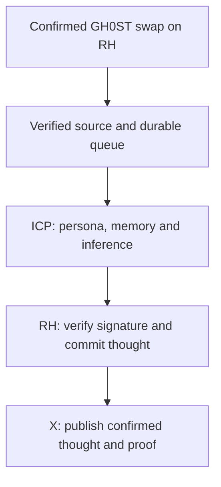

# GH0ST swap → thought → RH → X

## Product target

Every verified GH0ST swap in the supported RH venues creates one durable inference job. A model on ICP writes a short monologue in GH0ST's own cryptic, irreverent voice, using the swap and its persistent memory. The generated text is delivered to RH and confirmed there before the same text is published by the GH0ST X account with an explorer proof link.

The monologue is public creative commentary. The output does not need the model's thinking mode enabled. Personality consistency, references to earlier events and variety are evaluation goals; Terminal of Truths-style quality has not yet been measured for our candidate models.

## Transaction and delivery boundaries

1. **Swap signal.** The observer reads confirmed canonical swap logs from registered existing pools. A new minimal v4 `afterSwap` hook is an optional future route. A relayer delivers the log identity to ICP; the RH swap does not wait for inference.
2. **Source verification.** Verify successful receipt, chain, registered manager/pool, GH0ST currency membership, log identity and confirmation depth. A failed or reorged swap cannot create a valid thought job.
3. **Inference on ICP.** Build a bounded prompt from the canonical swap context, fixed persona and compact memory. Generate and validate an X-sized thought, then retain its exact text, hash and model provenance. Qwen3-1.7B Q4_K_M is the recommended next personality candidate; the current bridge remains pinned to 0.6B for infrastructure validation.
4. **Return to RH.** The coordinator signs the result. A relayer submits it in a separate RH transaction. The result contract verifies the signer and source identity, records the thought hash and emits the text. Later ICP or X failures must not affect the already-completed swap.
5. **Publish to X.** Wait for RH result confirmations and verify the event's answer hash. Publish the exact committed thought plus its RH proof URL. Persist the X post ID and its association with the swap and RH result. Update the character's memory from accepted history in a defined order.

The explicit authorized `requestInference` interface remains available. The direct route verifies an existing swap on ICP through `submit_swap`, then binds `fulfillSwapInference` to that source on RH. It avoids an extra RH request transaction. A new hook/pool is not required for this observation path.

## One identity throughout

Use a canonical source ID derived from `(chainId, manager, poolId, swapTransactionHash, logIndex)`. A transaction can contain more than one actual swap; each qualifying swap log gets its own identity. Verify pool keys against the GH0ST token address `0x2eb2849cde7957b86d0dfd4b59e450a9f9d15559`.

Persist the mapping:

`sourceId → inference job → thought hash → RH result transaction → X post ID`

Reject duplicate source IDs in both the coordinator and RH result contract. Use a durable FIFO inference queue and a separate publication queue. Multiple swaps may wait while a model job is running or X is rate-limited. Apply explicit cycle budgets and backpressure; do not silently drop swaps or regenerate a different thought because publication failed.

An X timeout can leave publication uncertain even if the post was created. Mark that delivery for reconciliation before retrying. Onchain deduplication does not itself provide exactly-once delivery to an external API.

## Existing GH0ST pool boundary

The current sentence-hook source pins its model and inference settings immutably and performs inference inside the EVM callback. Its frontend's `SPK1` hook data explicitly requests that existing speech behavior. Observing its confirmed canonical swap events is a possible initial integration, but it preserves the old inference gas and speech requirements.

A different lightweight hook requires a new v4 pool because the hook is part of the immutable pool key. No existing pool, hook, liquidity position or frontend has been changed by this architecture note. The saved pool initialization/liquidity report is dated 23 October; fresh RPC state was not established in this review.

The sentence-hook pool is not every possible GH0ST venue. Full token-wide coverage requires verified observers for all supported GH0ST pools and DEX protocols, including the separate recorded Pons pool. State supported coverage explicitly and add pool discovery/registration before making an unrestricted "every swap on RH" claim.

## X publisher boundary

Use the official create-post API, `POST https://api.x.com/2/tweets`, authorized by the GH0ST account with user-context credentials. OAuth 2.0 PKCE requires `tweet.read`, `tweet.write` and `users.read`; app-only authorization cannot publish. Keep those credentials in the publisher's secret store.

The publisher is a transport component: it validates and sends the committed text, without a second rewriting model. Check X's weighted character length before RH commitment and reserve space for the explorer URL. Respect API limits, avoid duplicate content and identify the account as an automated GH0ST agent. This flow concerns original posts; replies and mentions are separate features.

## Current implementation versus next work

| Component                              | Current checkpoint                                                                  | Required extension                                                                                |
| -------------------------------------- | ----------------------------------------------------------------------------------- | ------------------------------------------------------------------------------------------------- |
| RH request/result gateway              | Explicit and direct-swap callbacks, source deduplication                            | Live deployment and end-to-end confirmation                                                       |
| ICP verification/inference coordinator | Explicit and direct swap-proof ingestion, compiled to Wasm                          | Persona, memory, post-length validation and profile evaluation                                    |
| Transport worker                       | Confirmed registered-pool discovery, source-aware queue and callback reconciliation | Live integration and operational checks                                                           |
| Lightweight async v4 hook              | Design recorded                                                                     | New implementation, local integration checks and optional new-pool deployment                     |
| X publisher                            | API/auth requirements verified                                                      | Authenticated delivery queue, proof footer, post-ID journal and ambiguous-delivery reconciliation |
| Live operation                         | Not deployed                                                                        | Funded ICP deployment, model upload, measured inference, RH callback and X-account authorization  |

The original 17 checks cover the first bridge checkpoint. The existing-pool extension adds source/receipt/ABI, callback routing, confirmation and replay checks recorded in VALIDATION.md. Memory and X publishing remain unimplemented. No post was published and no account was connected during this review.

## Primary references

- [GH0ST immutable sentence hook](https://github.com/Gh0stllm/GH0ST/blob/research/v4-hook-1m/research/v4-hook-1m/swap-speaker-535k/contracts/SentenceSpeakerV4Hook.sol)
- [Existing pool configuration](https://github.com/Gh0stllm/GH0ST/blob/research/v4-hook-1m/research/v4-hook-1m/deployment/ghost-eth-pool.json), [dated pool status](https://github.com/Gh0stllm/GH0ST/blob/research/v4-hook-1m/research/v4-hook-1m/deployment/hook-pool-status.json), [separate source-market pool](https://github.com/Gh0stllm/GH0ST/blob/research/v4-hook-1m/research/v4-hook-1m/deployment/ghost-eth-market-reference.json)
- [Uniswap hook lifecycle and immutable pool-key FAQ](https://developers.uniswap.org/docs/protocols/v4/concepts/hooks)
- [X create-post API](https://docs.x.com/x-api/posts/create-post), [authentication mapping](https://docs.x.com/fundamentals/authentication/guides/v2-authentication-mapping), [automation rules](https://help.x.com/en/rules-and-policies/x-automation)
